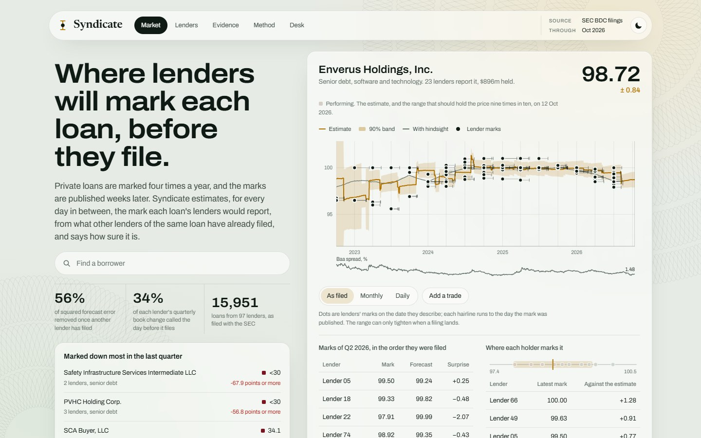
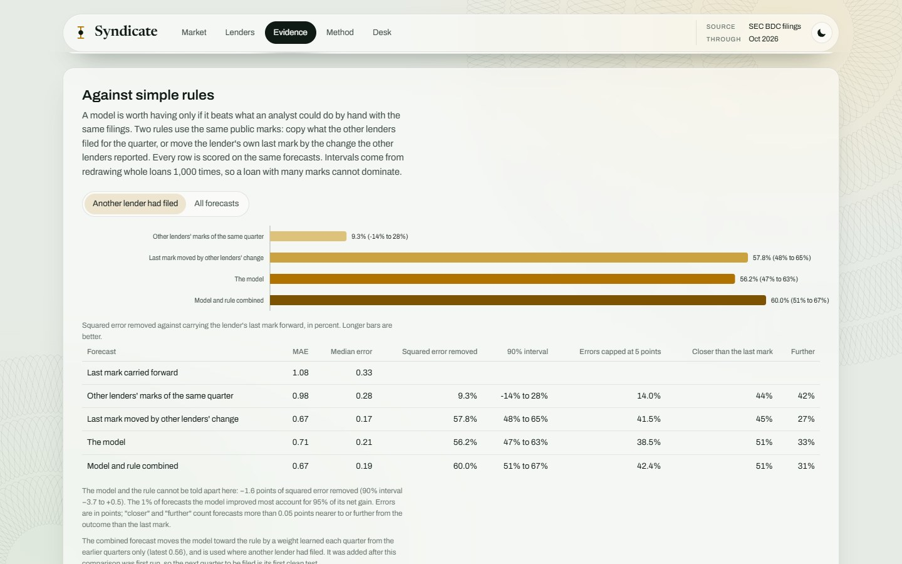
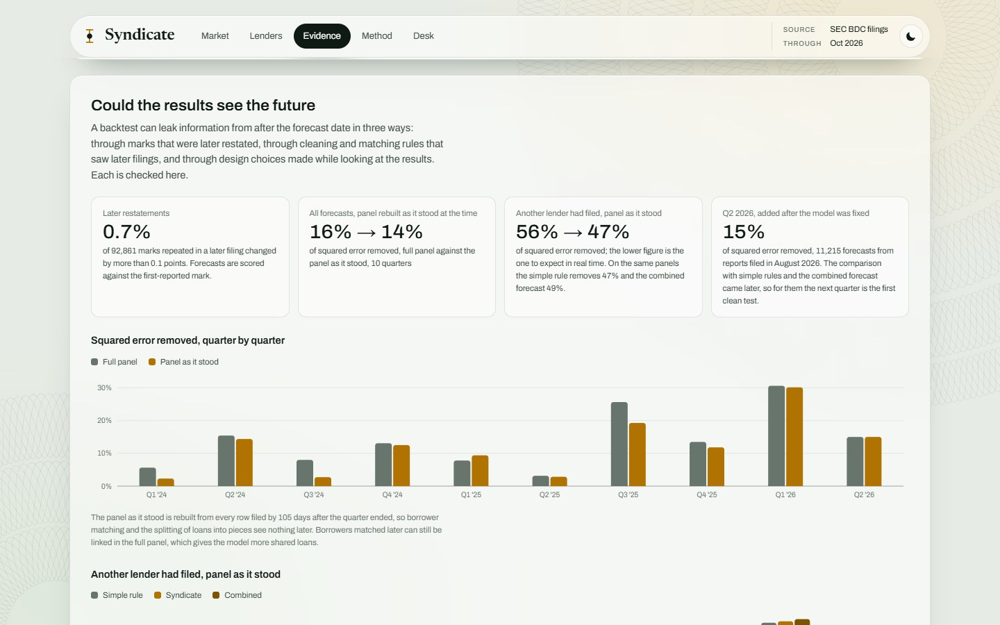
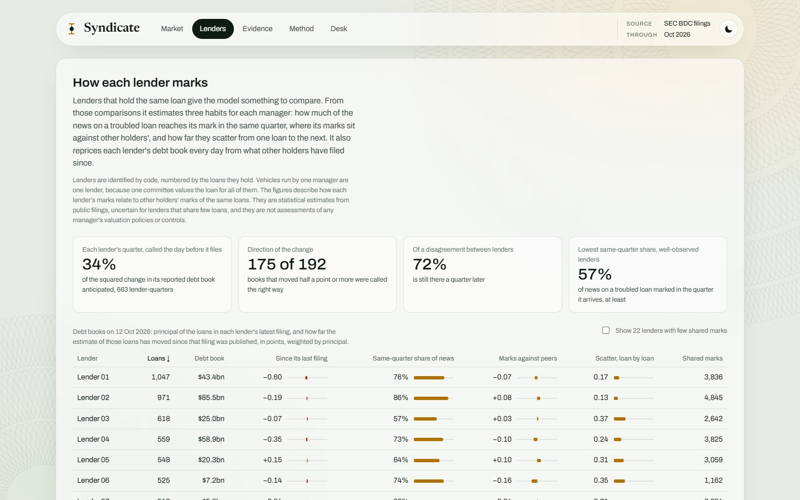
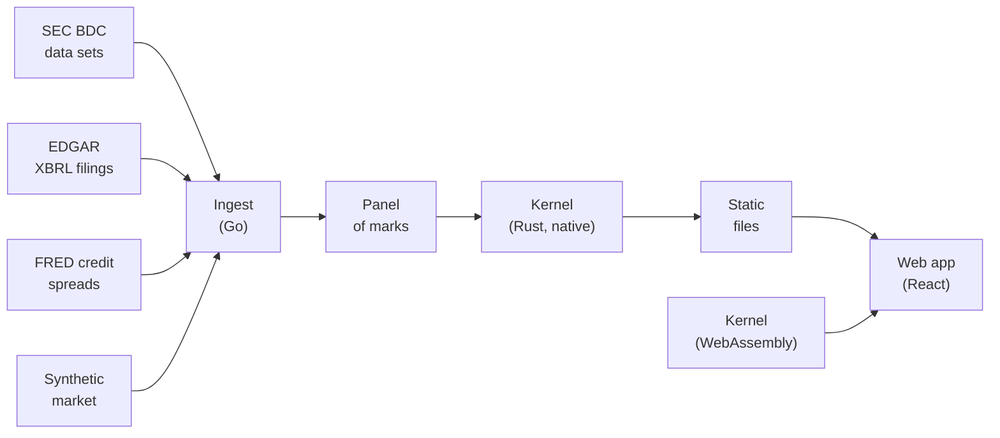
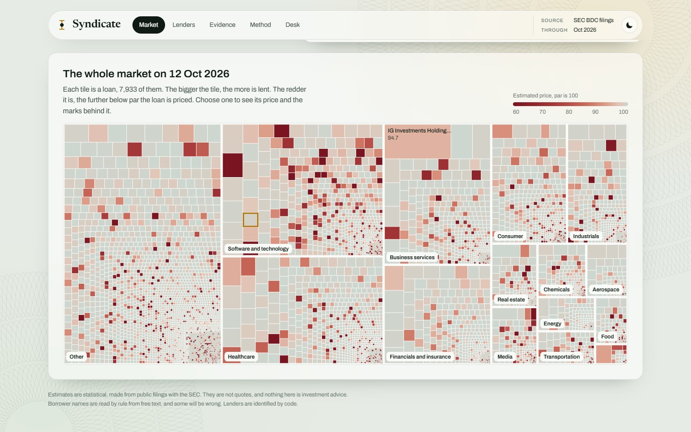
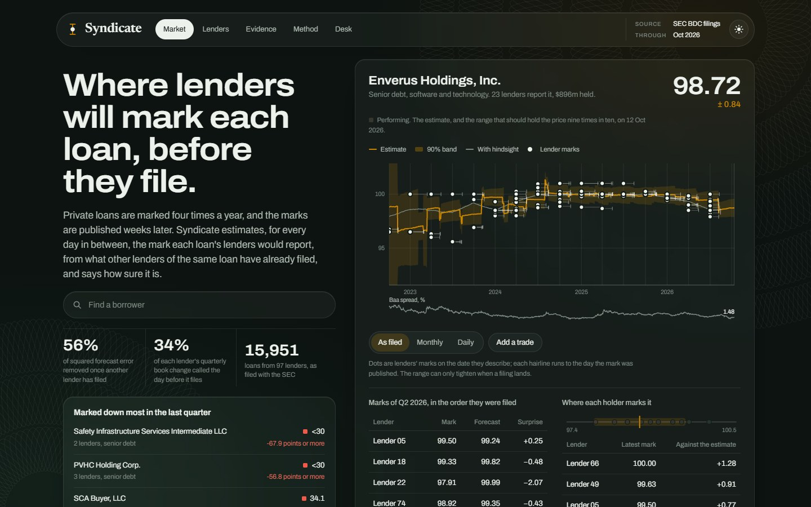

# Syndicate

**Intra-quarter Level 3 marks for private credit.**

[](https://github.com/Rishi0507/Syndicate-Intra-quarter-Level-3-marks/actions/workflows/ci.yml)

Syndicate estimates, for every day between quarterly filings, the mark that the lenders of a private
loan would report, with a calibrated 90% band. It reads each loan through the lenders that hold it:
once one holder has filed, the marks of the others can be anticipated, and so can the change in each
lender's debt book. It runs on the loan-level schedules of investments that business development
companies (BDCs) file with the SEC.

The estimate is a consensus mark, the value on which holders' marks agree once each lender's habits
are removed. It is not an independent fair value.

| Metric                  | Value                                                   |
| ----------------------- | ------------------------------------------------------- |
| Loans                   | 15,951, from 15,608 borrowers                           |
| Lender families         | 97, from 189 funds                                      |
| Marks                   | 224,823 fund marks, combined into 152,405 manager marks |
| Reporting periods       | September 2022 to June 2026                             |
| Out-of-sample forecasts | 97,521, over ten quarters                               |



> **Disclaimer.** Syndicate is independent research built from public filings and does not
> constitute investment advice. The site and its exported data identify lenders by code. Figures
> about a lender describe how its filed marks relate to other holders' marks of the same loans; they
> are statistical estimates and are not assessments of any manager's valuation policies or controls.

## Contents

- [Why it matters](#why-it-matters)
- [Key results](#key-results)
- [What the filings show about lenders](#what-the-filings-show-about-lenders)
- [How it works](#how-it-works)
- [Web application](#web-application)
- [Data](#data)
- [Getting started](#getting-started)
- [Repository layout](#repository-layout)
- [Documentation](#documentation)
- [Limitations](#limitations)
- [References](#references)

## Why it matters

Each BDC reports a fair value for every loan once a quarter, and the report becomes public weeks
later. These loans are Level 3 assets: almost none of them trades, and between filings there is no
observed price. A growing share of private credit sits in vehicles that issue and redeem shares
between quarter ends, at net asset values built from those marks, and investors, allocators and
risk teams need a view of where the marks stand in the meantime.

Many loans are held by more than one lender, and lenders file on different days. When more than
one manager reports a performing loan for the same date, the highest and lowest marks are more than
a point apart a third of the time. When one holder files, its mark is information about the loan for
every holder that has not. Syndicate is built on that structure; the name refers to it.

## Key results

All results are out of sample. For each of ten quarters, from 2024 Q1 to 2026 Q2, the model is
fitted on marks filed before the quarter ended and forecasts each mark of that quarter on the day
before the lender files it. Forecasts are scored against the first-reported mark. Errors are in
points, with par at 100. Every result is set against a rule an analyst could apply by hand with the
same filings: move the lender's own last mark by the change the other lenders have reported.
Intervals are 90%, from resampling whole loans.

| Squared error removed against the last mark                             | Model              | Simple rule | Combined |
| ----------------------------------------------------------------------- | ------------------ | ----------- | -------- |
| Another lender has already filed the loan (34,958 forecasts, 36% of all) | 56% (47% to 63%)   | 58%         | 60%      |
| The same, on panels rebuilt as they stood at the time                    | 47%                | 47%         | 49%      |
| All forecasts (97,521)                                                   | 16% (12% to 19%)   | 13%         | 17%      |
| All forecasts, on panels rebuilt as they stood                           | 14%                | 11%         | 14%      |

| Other results                                                            | Result                                                                                                  |
| ------------------------------------------------------------------------ | ------------------------------------------------------------------------------------------------------- |
| Each lender's quarterly debt book change, called the day before it files | 34% of the squared change anticipated (rule 26%); direction right for 175 of 192, against 170 for always calling a fall |
| 90% bands, performing, watch-list and stressed loans                     | Hold 87.8%, 88.3% and 90.4%; 7% to 12% narrower than a naive band at equal coverage                    |



- **Where another lender has filed, a simple rule does as well as the model.** The model removes 1.6
  points less squared error than the rule, with an interval of -3.7 to +0.5. Most of the value of
  those forecasts is in the other lenders' marks rather than in the model. The two make different
  errors, and moving the model toward the rule by a weight learned only from earlier quarters
  removes 60%. That combination was added after the comparison was run, so its first clean test is
  2026 Q3, filed from November 2026.
- **The model's lead over all forecasts is in large moves.** It removes 2.3 points more squared error
  than the rule (+1.4 to +3.2), because it also moves on loans no other lender has filed yet, and it
  anticipates more of the change in lenders' books. On the typical forecast it is not ahead: the
  rule has the lower mean and median error, and the 1% of forecasts the model improves most account
  for more than all of its net gain.
- **One part carries the model.** Without the standing distance between a lender and the other
  holders, 13 of the 16 points of squared error removed are lost. Late marking, the jump test, wider
  disagreement under stress and the pull to par add 0.7 to 2.7 points each. Each lender's level bias
  and public credit spreads add nothing measurable.
- **Shared prices flatter the headline.** On 13,473 of the 34,958 forecasts where another lender had
  filed, the lender's marks of that loan had already matched another holder's exactly after a move,
  a sign of a common quote or valuation agent. The model removes 72% of squared error there and 43%
  elsewhere, where the rule removes 44%.
- **The results survive a point-in-time rebuild.** Borrower matching and loan splitting use every
  filing in the panel. Rebuilding the panel for each quarter from rows filed by then lowers the
  model's share of squared error removed from 16% to 14% overall and from 56% to 47% where another
  lender had filed. The rebuilt figures are the ones to expect in real time.
- **Fresh data agrees, with a caveat.** 2026 Q2, mostly from reports filed in August 2026 and added
  after the model and every cleaning rule were fixed, shows 15% of squared error removed across
  11,215 forecasts, in line with earlier quarters. Where another lender had filed in that quarter,
  the rule did better than the model, 56% against 46%.
- **Restatements do not drive the results.** Of 92,861 marks that later filings repeat as
  comparatives, 0.7% change by more than a tenth of a point.



Full tables, including the comparison with simple rules, results by regime, by quarter and by
realised move, the band comparison, the ablation of every part of the model and the software
verification on a synthetic market, are in [docs/results.md](docs/results.md).

## What the filings show about lenders

These are read from the marks, before any forecasting.

- **Disagreement persists.** 72% of the distance between one lender's mark and its peers' marks on
  the same loan remains a quarter later. Most of it is a standing view of the loan, not noise.
- **Some news reaches marks late.** When the other holders of a loan mark it by a point or more and
  a lender does not, 20% of their move reaches that lender's mark in the next quarter. The other
  holders themselves move a further 13% the same way, so only part of the 20% is late marking and
  the rest is a trend in value. Estimates of lateness are upper bounds.
- **Marks are pulled toward par from both sides**, by 14% per quarter from below and 26% from above.
- **Public credit spreads explain little.** They account for 0.6% of the quarterly variation in
  marks.
- **Disagreement does not predict distress.** Among performing loans it ranks next quarter's
  markdowns of three points or more no better than chance (AUC 0.49).



## How it works



| Stage        | Approach                                                                                                                                                                                                                |
| ------------ | ----------------------------------------------------------------------------------------------------------------------------------------------------------------------------------------------------------------------- |
| Marks        | A lender's view of a loan is the consensus value plus a level bias and a standing distance that fades slowly. A mark and the same lender's previous mark together measure the value now less a share of the value then. |
| Delay        | Marks describe a quarter-end date and are published weeks later. A state-space filter keeps past values in its state, so a late mark corrects today's estimate exactly.                                                 |
| Peers        | Other lenders' marks of the same loan are measurements of the same value, read through each lender's own habits.                                                                                                        |
| Jumps        | The first mark of each quarter is tested against a jump, so a large fall is believed rather than discounted.                                                                                                            |
| Estimation   | Six steps, each identified by a different slice of the marks. No model parameter is hand-set.                                                                                                                           |
| Bands        | Split-conformal calibration, walk-forward and per regime.                                                                                                                                                               |
| Lender books | Each lender's book is repriced daily by the move in the estimate of its loans since its latest filing was published.                                                                                                    |

| Component | Language                       | Responsibility                                                                                                                                         |
| --------- | ------------------------------ | ------------------------------------------------------------------------------------------------------------------------------------------------------ |
| `ingest`  | Go, standard library only      | Streams the Schedule of Investments out of each archive, fills missing months from EDGAR, parses identifiers, resolves borrowers and writes the panel. |
| `kernel`  | Rust, no external dependencies | Filter, estimation, backtest, audit and export. One source builds a native program and a 145 KB WebAssembly module.                                    |
| `web`     | TypeScript and React           | Static interface. Every curve is recomputed in the browser by the WebAssembly kernel from the exported marks.                                          |

The browser and native builds agree to 3 parts in 10 million across 12,299 loan-days. The full fit,
backtest and export of the real panel runs in about twelve seconds. The specification is in
[docs/methodology.md](docs/methodology.md) and the system design in
[docs/architecture.md](docs/architecture.md).

## Web application

The interface is a static site with five pages.

| Page     | Content                                                                                                                                                    |
| -------- | ---------------------------------------------------------------------------------------------------------------------------------------------------------- |
| Market   | One loan in focus: the daily estimate and its 90% band against every filed mark, and where each holder stands. Below it, the whole market as a treemap.    |
| Lenders  | Each lender's debt book, its move since the last filing, timing, level against peers and scatter, and how well each lender's quarter is called in advance. |
| Evidence | Every result in this document, with charts, and the point-in-time audit.                                                                                   |
| Method   | The full specification, with the fitted values.                                                                                                            |
| Desk     | Exploratory. How the uncertainty of an estimate would carry into a dealer's spread and into liquidity, under stated assumptions.                           |

Every page and loan has its own address (`#/lenders`, `#/loan/412`). Light and dark themes are
supported, and each page states whether it shows SEC filings or the synthetic market.





## Data

The SEC's [BDC data sets](https://www.sec.gov/data-research/sec-markets-data/bdc-data-sets) carry
loan-level marks for every business development company from late 2022. The SEC requires automated
clients to identify themselves with a contact address, so the downloader does not run without one
and does not present itself as a browser:

```sh
export SEC_CONTACT="Your Name you@example.com"
bash scripts/pipeline.sh sec
```

The data sets are published monthly and a month can be missing or late. In October 2026 the SEC had
not published August 2026, the month in which most second-quarter reports were filed. The pipeline
fills any uncovered month from the filings' own XBRL on EDGAR, in the same row format; checked
against a month the SEC did publish, the conversion reproduces the same marks.

The repository contains no data. The archives, the panel and the files the site reads (`data/` and
`web/public/data/`) are generated locally. Of 1.97 million schedule rows, 911,265 restate an earlier
date in a later filing, 692,530 are removed by explicit cleaning rules and 361,876 are kept. The
rules, the reconciliation from rows to marks and the panel schema are in [docs/data.md](docs/data.md).

## Getting started

### Prerequisites

- Go 1.22 or later
- Rust (stable) with the `wasm32-unknown-unknown` target
- Node.js 20 or later

### Build and run

```sh
bash scripts/pipeline.sh synthetic     # synthetic market; no download required
bash scripts/pipeline.sh sec           # SEC filings; see Data
cd web && npm install && npm run dev   # http://127.0.0.1:5173
```

### Test

```sh
bash scripts/test.sh                   # Go tests, Rust tests, type check, browser against native
bash scripts/vintage.sh                # backtest on panels rebuilt as they stood each quarter
cd web && npm run build                # static site in web/dist
```

Continuous integration runs the Go, Rust and TypeScript checks on every pull request, then
generates the synthetic market and runs the whole pipeline on it. `scripts/cargo.sh` runs cargo
against the kernel manifest from anywhere in the repository and honours `CARGO_HOME` and
`RUSTUP_HOME`.

## Repository layout

```text
ingest/    Go          fetch, EDGAR fill, parse identifiers, resolve borrowers, build the panel, synthetic markets
kernel/    Rust        filter, calibration, engine, evaluation, audit, export, WebAssembly interface
web/       TypeScript  views, charts, data loading and kernel bindings
scripts/   Bash        pipeline.sh, test.sh, vintage.sh, cargo.sh
docs/                  results, methodology, data, architecture and screenshots
.github/               continuous integration
```

## Documentation

| Document                                     | Content                                                                                       |
| -------------------------------------------- | --------------------------------------------------------------------------------------------- |
| [docs/results.md](docs/results.md)           | Every result with its table: simple rules, accuracy, lender books, bands, audit, ablation, lender findings. |
| [docs/methodology.md](docs/methodology.md)   | The model, its estimation, what the marks identify, and the evaluation design.                |
| [docs/data.md](docs/data.md)                 | Sources, the EDGAR fill, cleaning rules, borrower resolution and the panel schema.            |
| [docs/architecture.md](docs/architecture.md) | Components, data flow, the static file contract, and how the build is verified.               |

## Limitations

- **Consensus, not a traded price.** The estimate is where lenders would mark a loan without delay.
  Where every holder is too generous, so is the estimate.
- **A simple rule matches the model where peers have filed.** On loans another lender has already
  marked, moving the lender's last mark by the others' change does as well as the model. The model's
  own contribution is on loans no one else has filed, where it is small, and in large moves.
- **Shared prices.** On many shared loans a lender's mark has matched another holder's exactly,
  which points to a common quote or valuation agent rather than independent views. Results on those
  loans are much stronger than on the rest.
- **Single-lender loans.** 12,426 of the 15,951 loans (78%) are held by one manager family over
  their whole life. For them the estimate is that lender's mark rolled forward, with a band that
  reflects it, and it adds little to the last mark.
- **Early disagreement.** When a loan is first reported by two or three lenders that disagree, the
  estimate can follow the wrong one for a quarter or two. The band is wide while it does.
- **Identification of lateness.** Late marking and a trend in a loan's value produce the same
  pattern in marks. The check described above bounds lateness from above; it does not identify it.
- **Matching with hindsight.** Borrower matching and the splitting of loans into pieces improve
  with later filings. The point-in-time rebuild measures the effect; the full-panel figures are
  higher than what a user would have seen at the time.
- **Entity resolution.** Borrowers are matched across lenders by name and loan terms. The rules
  prefer leaving two records apart to merging them, so some shared loans are missed, and some names,
  read by rule from free text, are wrong.
- **Independence of lenders.** The model treats lenders' valuation errors as independent given the
  loan. Lenders that share a third-party valuation agent are less independent than that.
- **Exploratory layer.** The quote and liquidity models on the Desk page depend on parameters that
  marks cannot identify and have not been tested against trades.

## References

- SEC, [Business Development Company data sets](https://www.sec.gov/data-research/sec-markets-data/bdc-data-sets)
- Federal Reserve Bank of St. Louis, [FRED](https://fred.stlouisfed.org/)
- M. Getmansky, A. Lo, I. Makarov, *An econometric model of serial correlation and illiquidity in hedge fund returns* (2004)
- V. Vovk, A. Gammerman, G. Shafer, *Algorithmic learning in a random world* (2005)
- O. Guéant, C.-A. Lehalle, J. Fernandez-Tapia, *Dealing with the inventory risk* (2013)
- L. Glosten, P. Milgrom, *Bid, ask and transaction prices in a specialist market with heterogeneously informed traders* (1985)
- R. Huang, H. Stoll, *The components of the bid-ask spread* (1997)
- M. Bruls, K. Huizing, J. van Wijk, *Squarified treemaps* (2000)
