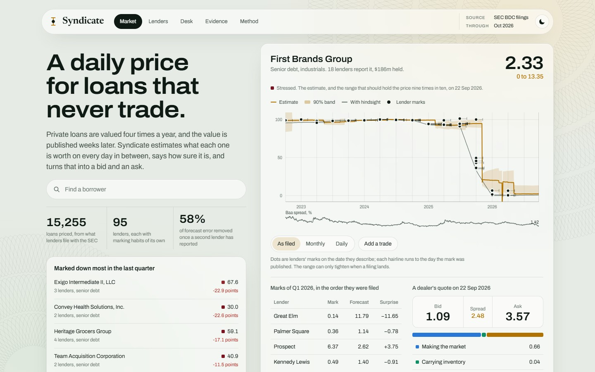
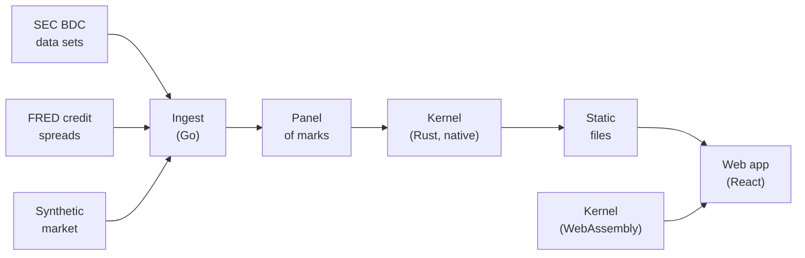

# Syndicate

**Intra-quarter Level 3 marks for private credit.**

Syndicate estimates the fair value of private loans on every day between quarterly marks, attaches a
calibrated confidence band to each estimate, and converts that uncertainty into an indicative
two-sided quote. It runs on the loan-level schedules of investments that business development
companies (BDCs) file with the SEC.

| Metric            | Value                       |
| ----------------- | --------------------------- |
| Loans priced      | 15,255                      |
| Lender families   | 95                          |
| Marks             | 208,442                     |
| Reporting periods | September 2022 to June 2026 |


> **Disclaimer.** Syndicate is independent research built from public filings and does not
> constitute investment advice. Lender names appear because they are disclosed in those filings.
> Figures shown beside them are statistical estimates and are not findings about any manager's
> valuation process.

## Contents

- [Background](#background)
- [Capabilities](#capabilities)
- [Results](#results)
- [Web application](#web-application)
- [Architecture](#architecture)
- [Data](#data)
- [Getting started](#getting-started)
- [Repository layout](#repository-layout)
- [Methodology](#methodology)
- [Limitations](#limitations)
- [References](#references)

## Background

Private credit is increasingly expected to offer investors daily pricing and, over time, a secondary
market. Large managers have announced daily valuations for private assets and have begun making
markets in them. Almost none of the underlying loans has ever traded.

These loans are Level 3 assets: their fair value rests on unobservable inputs. Each lender reports a
mark at quarter end, and the filing becomes public several weeks later. Between filings there is no
observed price.

Quoting such a loan requires two numbers every day: an estimate of value, and a measure of
confidence in that estimate. The second number sets the adverse-selection component of a dealer's
spread and is rarely available. Syndicate produces both.

The approach reads each loan through the lenders that hold it. When several lenders hold the same
loan, their marks for the same reporting date differ, and those differences carry information about
the loan and about each lender's marking behaviour. The name refers to that structure: one loan,
held by a syndicate of lenders, each of which marks it independently.

## Capabilities

| Capability         | Description                                                                                                                                                                       |
| ------------------ | --------------------------------------------------------------------------------------------------------------------------------------------------------------------------------- |
| Filing ingestion   | Parses each free-text investment identifier into borrower, seniority and facility, and resolves borrower names that different lenders spell differently.                          |
| Daily valuation    | A state-space filter rolls each loan's value forward and corrects it as marks are filed. Marks describe a date weeks in the past; the filter holds past values in its state.       |
| Lender profiling   | Estimates how late each lender is with news, how high it marks relative to its peers, and how long its disagreements with them persist.                                           |
| Calibrated bands   | Confidence bands are calibrated on out-of-sample forecast errors, and realised coverage is reported for each regime.                                                              |
| Indicative quotes  | The bid-ask spread is decomposed into three charges. The adverse-selection charge is proportional to the standard error of the price.                                             |
| Liquidity dynamics | Trades are modelled as measurements. The feedback between information and liquidity produces two regimes, and the model identifies the conditions that move a loan between them. |

## Results

### Out-of-sample accuracy

The panel covers the SEC BDC data sets from September 2022 to June 2026: 1.8 million schedule rows
from 184 funds, resolved to 14,931 borrowers and 15,255 loans, of which 3,418 are marked by more than
one manager.

All forecasts are out of sample. For each of ten quarters, 2024 Q1 to 2026 Q2, the model is fitted
only on marks filed before the quarter ended and then forecasts each mark of that quarter on the day
before the lender files. In total, 88,123 forecasts are scored against the marks lenders
subsequently reported.

| Information used                                   |  MAE | RMSE | Squared error removed |
| -------------------------------------------------- | ---: | ---: | --------------------: |
| Last mark carried forward                          | 1.20 | 3.93 |                       |
| Rolled forward with public spreads and pull to par | 1.47 | 4.40 |                  −25% |
| With each lender's habits modelled                 | 1.23 | 3.86 |                    4% |
| With other lenders' marks of the same loan         | 1.09 | 3.60 |                   16% |
| With sector repricing from other loans             | 1.09 | 3.60 |                   16% |

Errors are in price points, with par at 100. Each row adds one source of information to the row
above it.

- **A standard filter underperforms the naive benchmark.** Treating marks as fair value plus
  independent noise, rolled forward with public credit spreads, produces a forecast 25% worse than
  carrying the last mark forward.
- **Lender offsets are persistent.** Modelling each lender's distance from its peers as a persistent
  habit rather than noise restores parity with the last mark. Before a second lender has filed,
  little further information is available.
- **Peer marks carry the information.** Once another holder of the loan has filed, 58% of squared
  error is removed (31,518 forecasts; RMSE falls from 3.12 to 2.02).
- **Sector repricing adds no measurable accuracy on observed marks.** The component improves
  accuracy in simulation but contributes nothing on these filings.

The model outperforms the last mark in each of the ten quarters and in each regime, removing 11% of
squared error for performing loans, 25% for watch-list loans and 14% for stressed loans.

### Band calibration

| Loans      | Stated 90% band held | Gaussian band held | Width against a naive band |
| ---------- | -------------------: | -----------------: | -------------------------: |
| Performing |                87.7% |              77.8% |               18% narrower |
| Watch list |                87.7% |              56.5% |                9% narrower |
| Stressed   |                90.2% |              73.1% |               11% narrower |

For performing and watch-list loans, the calibrated bands fall about two points short of their
stated coverage, against a much larger shortfall for Gaussian bands. In 2026 Q1, a quarter of
performing loans moved by more than one point, compared with a fifth or fewer in every earlier
quarter, and bands calibrated on prior quarters did not anticipate the shift. The shortfall is
reported rather than tuned away.



### Empirical findings

The following are estimated from the filings and reported by `syndicate fit data/build`.

- **Disagreement persists.** 73% of the distance between one lender's mark and its peers' marks on
  the same loan remains a quarter later. On a third of performing loans held by more than one
  manager, the highest and lowest marks are more than one point apart.
- **Lenders incorporate bad news with a lag.** When the other holders mark a loan down by one point
  or more, a lender's own mark absorbs about three quarters of the move in the same quarter and the
  remainder in the next. Where peers already mark the loan below 97 and the lender does not, the
  adjustment is slower.
- **Public credit spreads explain little.** They account for 0.6% of the quarterly variation in
  marks.
- **Marks are pulled toward par from both sides**, by 14% per quarter from below and 26% from above.
- **Disagreement does not predict distress.** It ranks which shared loans will be marked down three
  points in the following quarter with an AUC of 0.65, but only because loans already in difficulty
  are both disputed and fragile. Among performing loans the AUC is 0.48.

### Validation on a synthetic market

Observed data cannot confirm whether estimates between marks are correct, because the value is never
observed. The repository therefore includes a generator that writes a market in the SEC's own file
format, with the measurement structure found in the real filings and the true value of every loan
recorded for every day. The same code runs on both.

| Parameter set in the generator                 | True | Recovered |
| ---------------------------------------------- | ---: | --------: |
| Share of a disagreement carried a quarter      | 0.80 |      0.78 |
| Share of an old mark carried, under stress     | 0.23 |      0.20 |
| Pull to par, per quarter                       | 0.14 |      0.14 |
| Public sensitivity, points per point of spread | 1.20 |      1.17 |

Against the true value between marks, the typical error is 0.52 points, compared with 0.72 for the
stale marks a holder would otherwise use, and the 90% band contains the true value 87% of the time.
In simulation the model removes 48% of forecast error, considerably more than on real filings,
because the simulated market has public spreads that matter and no shocks of a kind the model was
not designed for. The exercise validates the machinery; it is not a forecast of performance on real
data.

`syndicate backtest data/synth/build` and `syndicate truth data/synth/build` reproduce these results.

## Web application


The interface is a static site with five pages.

| Page     | Content                                                                                                                                                                                                      |
| -------- | ------------------------------------------------------------------------------------------------------------------------------------------------------------------------------------------------------------ |
| Market   | One loan in focus: the current estimate and its 90% band, the daily estimate against every filed mark, and an indicative bid and ask. Below it, the full market as a treemap, one tile per loan, coloured by price. |
| Lenders  | How each manager marks: timeliness, level relative to peers and distance from consensus.                                                                                                                     |
| Desk     | Decomposition of the spread, and the feedback between trading and information.                                                                                                                               |
| Evidence | Every result in this document, with charts.                                                                                                                                                                  |
| Method   | The full mathematical specification.                                                                                                                                                                         |

Every page and loan has its own address (`#/desk`, `#/loan/412`). Light and dark themes are
supported and the selection persists between visits. Each page states whether it is displaying SEC
filings or the synthetic market.


## Architecture



| Component | Language                       | Responsibility                                                                                                                                                           |
| --------- | ------------------------------ | ------------------------------------------------------------------------------------------------------------------------------------------------------------------------ |
| `ingest`  | Go, standard library only      | Streams the Schedule of Investments out of each archive without unpacking it, parses identifiers, resolves borrowers, writes the panel and generates synthetic markets. |
| `kernel`  | Rust, no external dependencies | Filter, estimation, walk-forward backtest, quote and liquidity model. One source builds a native command-line program and a 145 KB WebAssembly module.                  |
| `web`     | TypeScript, React, three.js    | Static interface. Every curve and quote is computed in the browser by the WebAssembly kernel from the exported marks.                                                   |

The browser and native builds are checked against each other: across 12,187 loan-days they agree to
3 parts in 10 million, the precision of the single-precision marks that cross the wire. The full fit,
ten-quarter backtest and export of the real panel completes in about nine seconds.

Component diagrams, data flow and the build process are described in
[docs/architecture.md](docs/architecture.md).

## Data

The SEC's [BDC data sets](https://www.sec.gov/data-research/sec-markets-data/bdc-data-sets) carry
loan-level marks for every business development company from late 2022. The SEC requires automated
clients to identify themselves with a contact address, so the downloader does not run without one
and does not present itself as a browser:

```sh
export SEC_CONTACT="Your Name you@example.com"
bash scripts/pipeline.sh sec
```

Alternatively, download the `*_bdc.zip` archives manually into `data/raw/sec` and run the same
command without `SEC_CONTACT`.

The repository contains no data. The archives, the panel and the files the site reads (`data/` and
`web/public/data/`) are generated locally by the pipeline.

The filings require substantial cleaning, and most of the ingest code exists for that purpose.
Published column names do not match the columns that hold the values. Four families of free-text
identifier are in use, some with the first letter of the borrower missing and some with schedule
headings run into the name. Unfunded commitments resemble loans marked at zero, euro-denominated
loans resemble loans marked at 108, and a small number of rows are a thousand times too large. A
single borrower and seniority can conceal a first-out and a last-out piece, or new paper issued in a
restructuring. Each case is handled by an explicit rule, and `data/build/ingest_report.json` counts
the effect of every rule on every row. Of 1.84 million rows, 851,299 restate an earlier date in a
later filing, 662,326 are dropped and 328,783 are kept.

The cleaning rules and the panel schema are documented in [docs/data.md](docs/data.md).

## Getting started

### Prerequisites

- Go 1.22 or later
- Rust (stable) with the `wasm32-unknown-unknown` target
- Node.js 20 or later

### Build and run

```sh
bash scripts/pipeline.sh synthetic     # synthetic market; no download required
bash scripts/pipeline.sh sec           # SEC filings; see Data
cd web && npm install && npm run dev   # http://127.0.0.1:5173
```

### Test

```sh
bash scripts/test.sh                   # Go tests, Rust tests, type check, browser against native
cd web && npm run build                # static site in web/dist
```

`scripts/cargo.sh` runs cargo against the kernel manifest from anywhere in the repository. It uses
`CARGO_HOME` and `RUSTUP_HOME` when they are set, for toolchains installed outside the default
location.

## Repository layout

```text
ingest/    Go          fetch, parse identifiers, resolve borrowers, build the panel, synthetic markets
kernel/    Rust        filter, calibration, engine, evaluation, quote, liquidity, WebAssembly interface
web/       TypeScript  views, charts, data loading and kernel bindings
scripts/   Bash        pipeline.sh, test.sh, cargo.sh
docs/                  architecture, methodology, data notes and screenshots
```

## Methodology

The site's Method page and [docs/methodology.md](docs/methodology.md) contain the full
specification. In summary:

| Element        | Approach                                                                                                                                                                                                                                                                     | Source                                    |
| -------------- | ---------------------------------------------------------------------------------------------------------------------------------------------------------------------------------------------------------------------------------------------------------------------------- | ----------------------------------------- |
| Value          | A loan's value moves daily with a public credit spread, a shock shared by its sector and news of its own. Sensitivity and volatility rise as the loan becomes stressed.                                                                                                       | [`filter.rs`](kernel/src/filter.rs)       |
| Marks          | A lender's view is fair value plus a level bias and a persistent distance. A mark and the same lender's previous mark together measure the value now less a share of the value then, with only the fresh part of the disagreement as noise.                                  | [`filter.rs`](kernel/src/filter.rs)       |
| Delayed filing | On each reporting date the filter copies the current value into a state slot. A mark filed weeks later updates the slot and, through its correlation with the present, corrects today's estimate exactly.                                                                     | [`filter.rs`](kernel/src/filter.rs)       |
| Smoothing      | A fair value cannot be forecast from its own past. If peers' marks last quarter predict a lender's change this quarter, that lender is marking late, by the ratio of two covariances. No public market is required.                                                          | [`calib.rs`](kernel/src/calib.rs)         |
| Other loans    | Each loan is filtered alone, then receives the surprises of the other loans in its sector, week by week as they are filed, with its own excluded.                                                                                                                             | [`engine.rs`](kernel/src/engine.rs)       |
| Jumps          | The first mark of each quarter is tested against a jump. The belief becomes a two-part mixture, collapsed back to a single Gaussian.                                                                                                                                         | [`filter.rs`](kernel/src/filter.rs)       |
| Estimation     | Six steps, each identified by a different slice of the marks. No model parameter is hand-set; a short list of thresholds is fixed by design, such as the price of 97 below which a loan counts as stressed.                                                                  | [`calib.rs`](kernel/src/calib.rs)         |
| Bands          | Split-conformal calibration, walk-forward and per regime, on the model's standard deviation plus the typical error of the regime.                                                                                                                                            | [`eval.rs`](kernel/src/eval.rs)           |
| Quote          | Guéant, Lehalle and Fernandez-Tapia for making the market and carrying inventory; Glosten and Milgrom for adverse selection, which is linear in the price's standard error.                                                                                                  | [`quote.rs`](kernel/src/quote.rs)         |
| Liquidity      | The variance of the market's estimate grows daily and is reduced by every mark and every trade. Trades arrive faster when the spread is tighter, and the spread is tighter when the variance is lower. The process is simulated exactly and reduced to an equation whose rest points fold. | [`liquidity.rs`](kernel/src/liquidity.rs) |

## Limitations

- **Consensus, not a traded price.** The estimate is where lenders would mark a loan today without
  delay. Where every lender is too generous, so is the estimate.
- **Single-lender loans.** Before a second lender has filed, the model knows little that the last
  mark does not. Three quarters of these loans have one lender; for them the estimate is that
  lender's mark rolled forward, with a band that reflects it.
- **Early disagreement.** When a loan is first reported by two or three lenders that disagree, the
  estimate can follow the wrong one for a quarter or two before the rest outweigh it. The band is
  wide while it does.
- **Identification of smoothing.** Smoothing is read from serial dependence, as is standard for
  hedge funds and private equity. A loan whose true value fell steadily for its own reasons would be
  indistinguishable from a lender marking it down late.
- **Entity resolution.** Borrowers are matched across lenders by name and loan terms, and pieces of
  one borrower's debt are separated by their marks. Both rule sets prefer leaving two records apart
  to merging them, so some shared loans are missed and some merges are incorrect. Names are read by
  rule from free text, and some are wrong.
- **Desk assumptions.** The desk parameters, such as how many clients request quotes and how
  aggressively they shop, cannot be estimated from marks. They are assumptions to be varied, and
  every quote inherits them.
- **Independence of lenders.** The model treats lenders' valuation errors as independent given the
  loan. Lenders that share a third-party valuation agent are less independent than that.
- **Liquidity model.** The liquidity results describe a market that barely exists yet. One
  prediction is testable with trade data: loans should trade most in the weeks after their lenders
  file.

## References

- SEC, [Business Development Company data sets](https://www.sec.gov/data-research/sec-markets-data/bdc-data-sets)
- Federal Reserve Bank of St. Louis, [FRED](https://fred.stlouisfed.org/)
- O. Guéant, C.-A. Lehalle, J. Fernandez-Tapia, *Dealing with the inventory risk* (2013)
- L. Glosten, P. Milgrom, *Bid, ask and transaction prices in a specialist market with heterogeneously informed traders* (1985)
- R. Huang, H. Stoll, *The components of the bid-ask spread* (1997)
- M. Getmansky, A. Lo, I. Makarov, *An econometric model of serial correlation and illiquidity in hedge fund returns* (2004)
- M. Bruls, K. Huizing, J. van Wijk, *Squarified treemaps* (2000)
- V. Vovk, A. Gammerman, G. Shafer, *Algorithmic learning in a random world* (2005)
