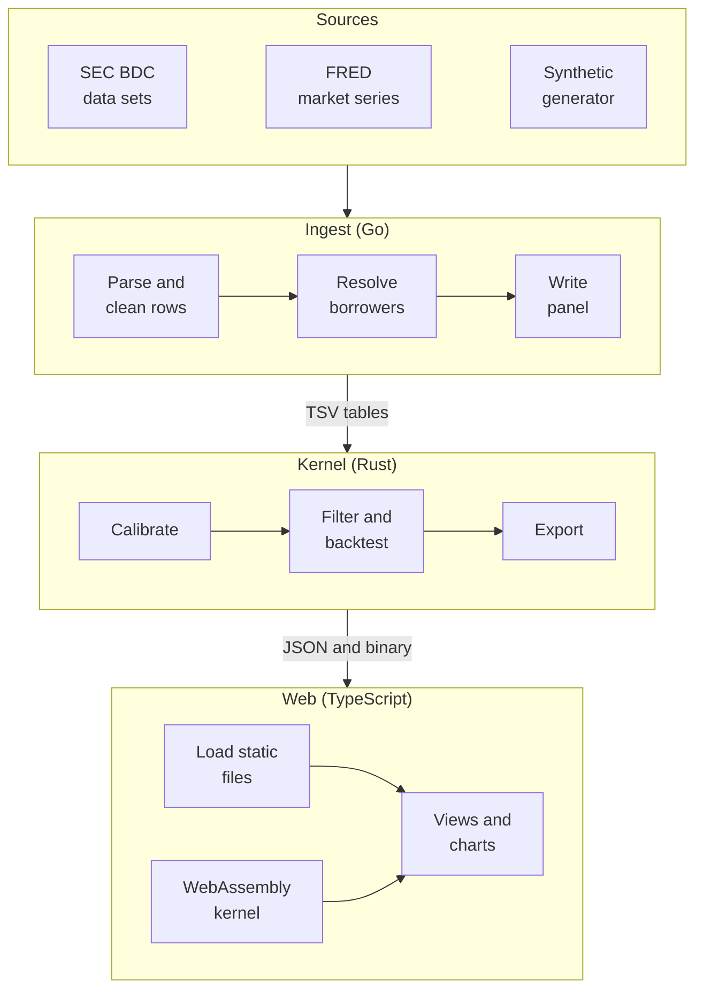
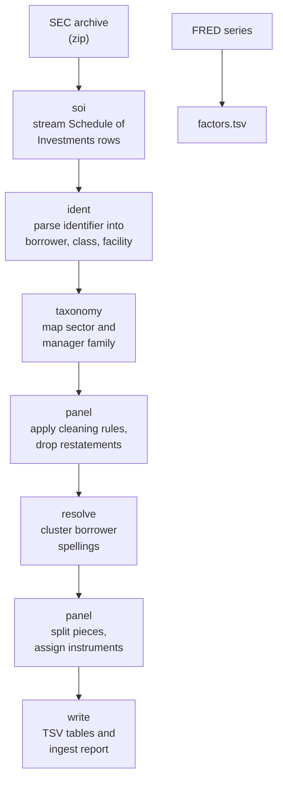
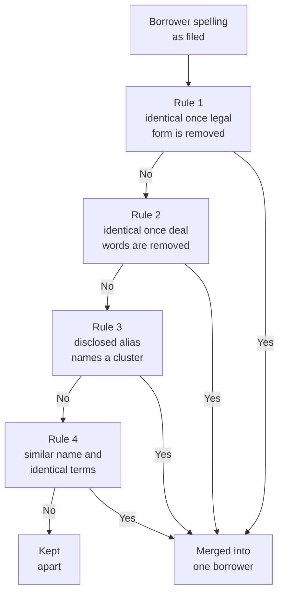

# Architecture

This document describes the components of Syndicate, the data that moves between them, and how the
system is built and verified.

## Contents

- [System overview](#system-overview)
- [Ingest](#ingest)

## System overview

Syndicate is three programs connected by files. There is no server and no database. Each stage
writes plain files that the next stage reads, so any stage can be rerun, inspected or replaced on
its own.

| Stage  | Input                                     | Output                                         | Location                   |
| ------ | ----------------------------------------- | ---------------------------------------------- | -------------------------- |
| Fetch  | SEC and FRED endpoints                    | `*_bdc.zip` archives, daily market series      | `data/raw/`                |
| Ingest | Archives and market series                | Panel of marks as tab-separated tables, report | `data/build/`              |
| Kernel | Panel                                     | Fitted model, backtest, static site files      | `web/public/data/`         |
| Web    | Static files and the WebAssembly kernel   | Interactive site                               | `web/dist/` after a build  |

The synthetic generator writes archives in the SEC's own format, so the synthetic market passes
through exactly the same ingest and kernel code as the real filings.

## Ingest

The ingest program is written in Go using only the standard library. It reads each archive as a
stream, without unpacking it to disk.

### Commands

| Command            | Purpose                                                                    |
| ------------------ | -------------------------------------------------------------------------- |
| `ingest fetch-sec` | Downloads the SEC BDC data sets. Requires `SEC_CONTACT`.                   |
| `ingest fetch-fred`| Downloads public market series from FRED.                                  |
| `ingest build`     | Parses, cleans and resolves the archives, then writes the panel.           |
| `ingest synth`     | Generates a synthetic market with a known answer and builds its panel.     |
| `ingest inspect`   | Shows how one archive's identifiers are being parsed.                      |

### Pipeline

| Package    | Responsibility                                                                                                         |
| ---------- | ---------------------------------------------------------------------------------------------------------------------- |
| `fetch`    | Downloads the public inputs. Declares a contact address to the SEC and never presents itself as a browser.             |
| `soi`      | Streams the Schedule of Investments report. Columns are located by name, never by position.                            |
| `ident`    | Parses free-text investment identifiers. Four grammar families are handled, including industry labels run into names.  |
| `taxonomy` | Maps filer labels onto a shared set of industry sectors and manager families.                                          |
| `resolve`  | Decides which borrower names, written differently by different lenders, refer to the same company.                     |
| `panel`    | Applies the cleaning rules, removes restatements, separates distinct pieces of debt and writes the panel.              |
| `synth`    | Generates a market in the SEC file format, with the true value of every loan recorded for every day.                   |
| `day`      | Calendar dates as `yyyymmdd` integers, converted to serial day numbers only where arithmetic is needed.                |

### Borrower resolution

Every downstream comparison is between lenders' marks of the same loan, so a false merge is the
costly error: it creates disagreement between two loans that were never the same. The resolver
therefore leaves names apart unless the names agree after normalisation or the reported loan terms
corroborate the match.

Rule 2 trusts a match of several words outright. A match on a single word, which is common across
unrelated companies, also requires the loans' maturity month and margin to agree. On the real panel,
25,639 distinct spellings resolve to 14,931 borrowers, and the rule that made each merge is recorded
in the ingest report.
