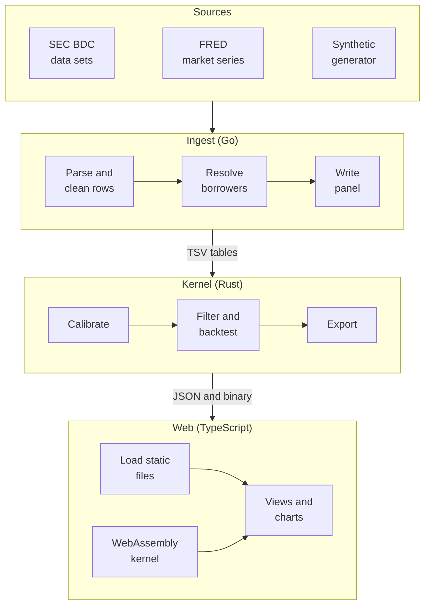
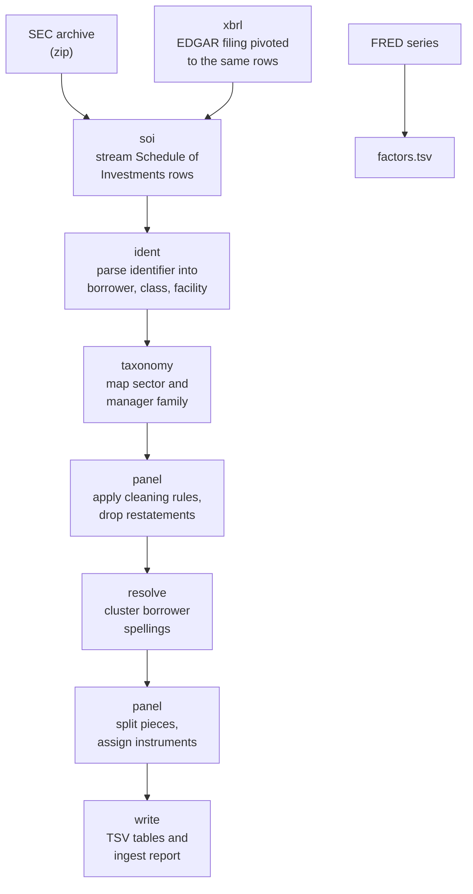
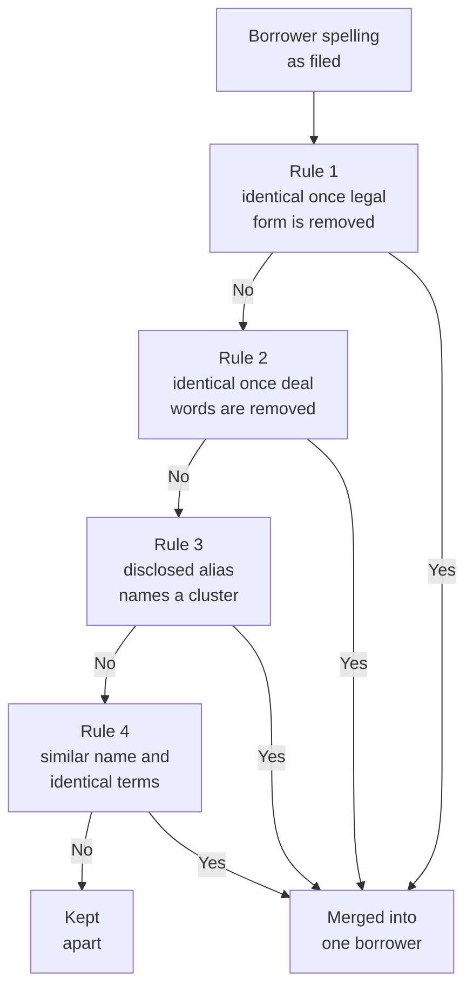
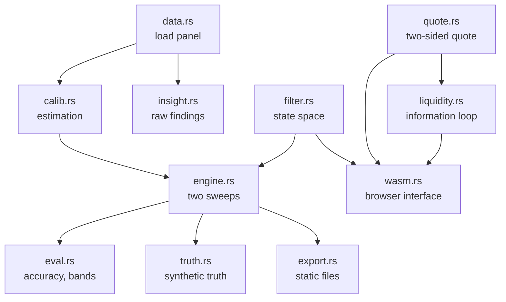
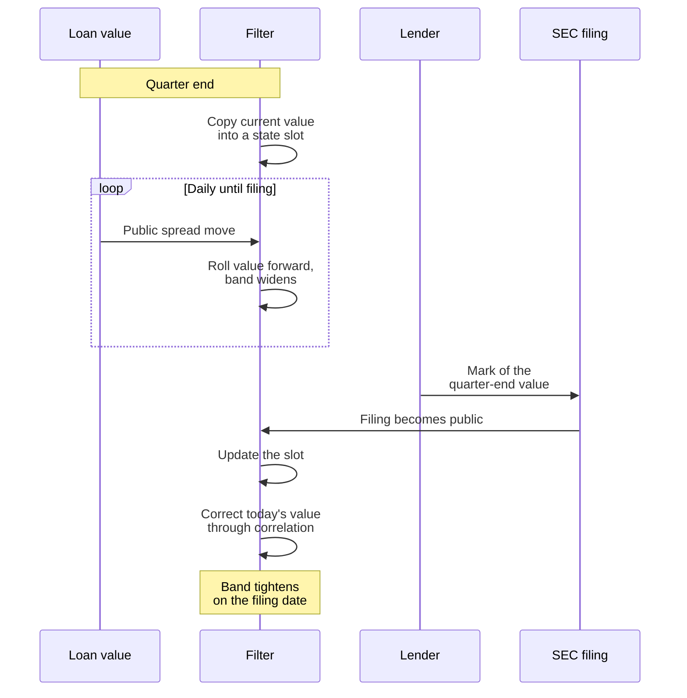
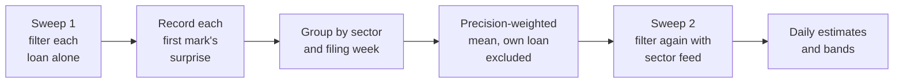
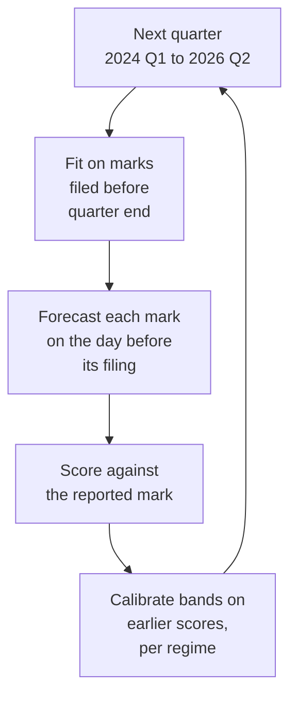
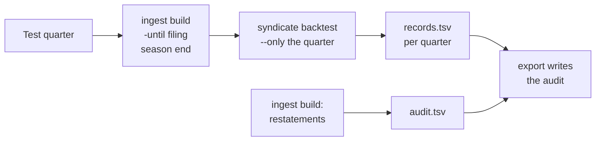
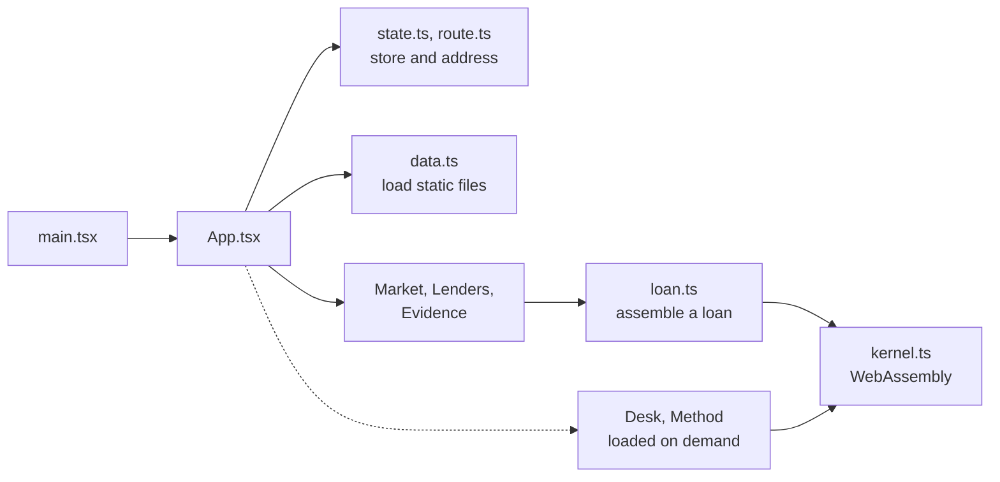
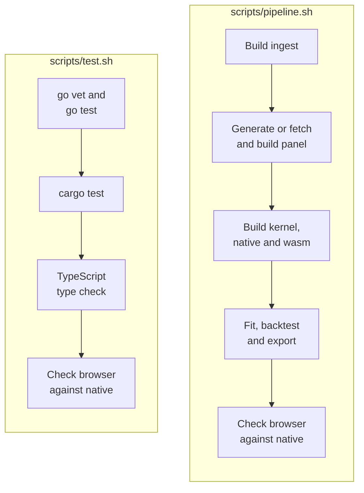

# Architecture

This document describes the components of Syndicate, the data that moves between them, and how the
system is built and verified.

## Contents

- [System overview](#system-overview)
- [Ingest](#ingest)
- [Kernel](#kernel)
- [Web application](#web-application)
- [Build and verification](#build-and-verification)
- [Design decisions](#design-decisions)

## System overview

Syndicate is three programs connected by files. There is no server and no database. Each stage
writes plain files that the next stage reads, so any stage can be rerun, inspected or replaced on
its own.

| Stage  | Input                                     | Output                                         | Location                   |
| ------ | ----------------------------------------- | ---------------------------------------------- | -------------------------- |
| Fetch  | SEC, EDGAR and FRED endpoints             | `*_bdc.zip` archives, daily market series      | `data/raw/`                |
| Ingest | Archives and market series                | Panel of marks as tab-separated tables, report | `data/build/`              |
| Kernel | Panel                                     | Fitted model, backtest, static site files      | `web/public/data/`         |
| Web    | Static files and the WebAssembly kernel   | Interactive site                               | `web/dist/` after a build  |

The synthetic generator writes archives in the SEC's own format, so the synthetic market passes
through exactly the same ingest and kernel code as the real filings.

## Ingest

The ingest program is written in Go using only the standard library. It reads each archive as a
stream, without unpacking it to disk.

### Commands

| Command              | Purpose                                                                                                    |
| -------------------- | ---------------------------------------------------------------------------------------------------------- |
| `ingest fetch-sec`   | Downloads the SEC BDC data sets. Requires `SEC_CONTACT`.                                                   |
| `ingest fetch-edgar` | Fills months the data sets do not cover from EDGAR XBRL. Requires `SEC_CONTACT`.                           |
| `ingest fetch-fred`  | Downloads public market series from FRED.                                                                  |
| `ingest build`       | Parses, cleans and resolves the archives, then writes the panel. `-until` ignores rows filed after a date. |
| `ingest synth`       | Generates a synthetic market with a known answer and builds its panel.                                     |
| `ingest inspect`     | Shows how one archive's identifiers are being parsed.                                                      |

### Pipeline

| Package    | Responsibility                                                                                                         |
| ---------- | ---------------------------------------------------------------------------------------------------------------------- |
| `fetch`    | Downloads the public inputs. Declares a contact address to the SEC and never presents itself as a browser.             |
| `xbrl`     | Pivots the XBRL instance of one periodic filing into Schedule of Investments rows, for months the data sets omit.     |
| `soi`      | Streams the Schedule of Investments report. Columns are located by name, never by position.                            |
| `ident`    | Parses free-text investment identifiers. Four grammar families are handled, including industry labels run into names.  |
| `taxonomy` | Maps filer labels onto a shared set of industry sectors and manager families.                                          |
| `resolve`  | Decides which borrower names, written differently by different lenders, refer to the same company.                     |
| `panel`    | Applies the cleaning rules, removes restatements, separates distinct pieces of debt and writes the panel.              |
| `synth`    | Generates a market in the SEC file format, with the true value of every loan recorded for every day.                   |
| `day`      | Calendar dates as `yyyymmdd` integers, converted to serial day numbers only where arithmetic is needed.                |

### Borrower resolution

Every downstream comparison is between lenders' marks of the same loan, so a false merge is the
costly error: it creates disagreement between two loans that were never the same. The resolver
therefore leaves names apart unless the names agree after normalisation or the reported loan terms
corroborate the match.

Rule 2 trusts a match of several words outright. A match on a single word, which is common across
unrelated companies, also requires the loans' maturity month and margin to agree. On the real panel,
25,639 distinct spellings resolve to 14,931 borrowers, and the rule that made each merge is recorded
in the ingest report.

## Kernel

The kernel is a Rust crate with no external dependencies. One source builds two targets: a native
library and command-line program used for calibration and backtesting, and a WebAssembly module
that the browser calls directly.

### Modules

`stats.rs` (normal distribution, robust summaries, small dense linear algebra and a deterministic
random number generator) and `json.rs` (a minimal JSON writer) support every module and are omitted
from the diagram.

### Commands

| Command                                  | Purpose                                                                                                                  |
| ---------------------------------------- | ------------------------------------------------------------------------------------------------------------------------ |
| `syndicate fit <build-dir>`              | Estimates every parameter from the marks and reports the findings.                                                       |
| `syndicate backtest <build-dir>`         | Runs the walk-forward backtest. `--only yyyy-mm` limits it to one quarter, `--records` writes every forecast.            |
| `syndicate truth <build-dir>`            | Scores daily estimates against the true value (synthetic data only).                                                     |
| `syndicate export <build-dir> <out-dir>` | Fits, backtests, filters every loan and writes the site's files. Lenders are written as codes unless `--named` is given. |
| `syndicate rest <parameters>`            | Solves for the rest points of the liquidity model.                                                                       |

### Delayed measurements

A lender's mark describes the quarter-end date but becomes public weeks later. The filter treats
this exactly by keeping the past in its state.

A mark and the same lender's previous mark together measure the value now less a share of the value
then, with only the fresh part of the disagreement as noise. Both values are in the state, so the
update is an ordinary linear measurement and no additional state per lender is required.

### Sector feed (ablation)

Loans are filtered independently, which keeps thousands of them tractable. The engine can restore a
link between loans in the same sector with a second sweep. The backtest scores this as an ablation:
it changes the forecast error on the filings by 0.01%, so the model the site uses filters each loan
once and the second sweep is not run.

### Walk-forward backtest

Every reported accuracy figure is out of sample. The model never sees a mark that was filed after
the date of the forecast being scored.

### Point-in-time audit

Borrower matching, the splitting of loans into pieces and some cleaning rules use every filing in the
panel. The audit rebuilds the panel for each test quarter from rows filed by then and repeats the
backtest for that quarter alone. The export reads the results, and those of the restatement check
made during ingest, into the site's audit section.

### Static file contract

The export writes everything the site needs. Per-loan daily curves are not exported, because there
are too many. The marks are, and the browser recomputes any loan's curve with the same code the
native program uses.

Lender families are written as codes, `Lender 01` for the family holding the most live loans and so
on, so that the site does not publish named rankings of managers. `--named` writes the names as filed,
for private analysis.

| File          | Format                   | Content                                                                                               |
| ------------- | ------------------------ | ----------------------------------------------------------------------------------------------------- |
| `meta.json`   | JSON                     | Source, daily grid, fitted parameters, lender codes, backtest, audit, findings.                       |
| `loans.json`  | JSON, column-oriented    | One entry per loan: name, sector, class, lenders, size, current estimate.                             |
| `marks_i.bin` | Unsigned 16-bit integers | For each mark: lender family, reporting date, filing date.                                            |
| `marks_f.bin` | 32-bit floats            | For each mark: price, previous mark, principal, and two fields reserved for the sector feed ablation. |
| `path.bin`    | One-byte codes           | A compressed path of each loan's estimate and standard error.                                         |

## Web application

The site is written in TypeScript with React. three.js is used only for the liquidity surface on the
Desk page. The Method and Desk pages are loaded on demand, so the mathematics library and the 3D
library are fetched only when those pages are opened.

The kernel interface is a set of plain C functions over the module's linear memory. The page
allocates a buffer, writes 64-bit floats into it, calls a function and reads floats back. There is
no generated glue code and no serialisation layer.

| Function                   | Purpose                                                       |
| -------------------------- | ------------------------------------------------------------- |
| `px_alloc`, `px_free`      | Allocate and release buffers in the module's memory.          |
| `px_curve`                 | Daily estimate and standard error for one loan.               |
| `px_daily_var`             | Daily variance of a loan's value at a given price.            |
| `px_quote`                 | Bid, ask and the three components of the spread.              |
| `px_adverse_width`         | Adverse-selection width for a given share of informed clients.|
| `px_rest`, `px_manifold`   | Rest points and surface of the liquidity model.               |
| `px_simulate`, `px_census` | Exact simulation of the liquidity process.                    |

## Build and verification

`scripts/pipeline.sh` builds every component from source and produces the site's data.
`scripts/test.sh` runs every test in the repository, and `scripts/vintage.sh` runs the
point-in-time audit. All three run on Linux, macOS and Windows.

The consistency check loads the same static files the site loads, runs the site's own code against
the WebAssembly module, and compares the result with daily paths the native program writes at full
precision. Marks reach the browser in single precision, so agreement is to about seven significant
figures. On the real panel, 12 loans and 12,299 loan-days agree within 2.8e-7 of par against a
tolerance of 2e-6.

### Continuous integration

`.github/workflows/ci.yml` runs on every pull request and on pushes to `main`. Three jobs check the
components independently, and a fourth runs the whole system on the synthetic market, which needs no
download because it is written in the SEC's own file format.

| Job                          | Steps                                                                                         |
| ---------------------------- | --------------------------------------------------------------------------------------------- |
| Ingest (Go)                  | `gofmt`, `go vet`, `go test`                                                                  |
| Kernel (Rust)                | `cargo test --lib`, WebAssembly release build                                                 |
| Web (TypeScript)             | `npm ci`, type check, production build                                                        |
| Synthetic market, end to end | `scripts/pipeline.sh synthetic`, browser against native, `syndicate truth` on the known answer |

## Design decisions

| Decision                                   | Rationale                                                                                                                                                                                                                           |
| ------------------------------------------ | ----------------------------------------------------------------------------------------------------------------------------------------------------------------------------------------------------------------------------------- |
| Files between stages, no database          | Each stage can be rerun and inspected on its own, and the site can be hosted from any static file server.                                                                                                                           |
| Go for ingest                              | The work is mostly I/O and string handling over about two million rows. The standard library covers it and builds in seconds.                                                                                                       |
| Rust for the kernel, without dependencies  | One source compiles to native code for estimation and to a small WebAssembly module for the browser.                                                                                                                                |
| Computation in the browser                 | Curves are recomputed from marks on demand, so the site ships marks rather than millions of daily points.                                                                                                                           |
| A synthetic market in the real file format | The full pipeline can be tested without network access, and estimates can be scored against a known truth.                                                                                                                          |
| Conservative entity resolution             | A false merge creates disagreement that does not exist. Missing a match costs less than inventing one.                                                                                                                              |
| Three languages, joined by files           | Each language fits its stage: Go for streaming I/O, Rust for numerics that must run natively and in the browser, TypeScript for the interface. The boundaries are file formats, so each component can be rebuilt or replaced alone. |
| Lender codes by default                    | The site describes statistical relationships between lenders' marks. Publishing them under codes avoids presenting named rankings of managers.                                                                                      |
| An exploratory layer kept apart            | The quote and liquidity models depend on parameters marks cannot identify. They are confined to one page that says so.                                                                                                              |
| Fill missing data months from source       | When the SEC's monthly data set lags, the same rows are rebuilt from the filings' XBRL, checked against a month the SEC did publish.                                                                                                |
