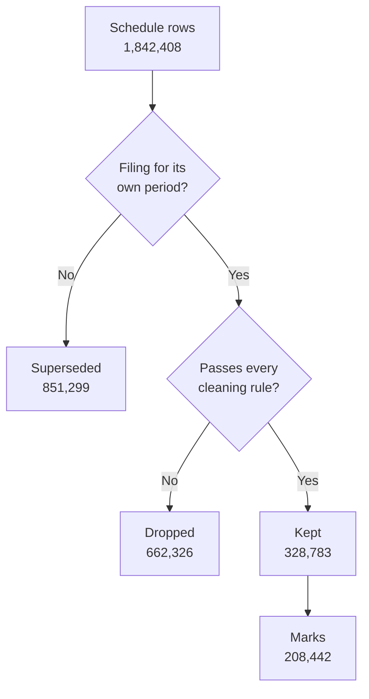

# Data

This document describes the inputs Syndicate uses, the rules that turn raw filings into a panel of
marks, and the format of that panel.

The repository contains no data. Every file described here is generated locally by
`scripts/pipeline.sh`.

## Contents

- [Sources](#sources)
- [From filings to marks](#from-filings-to-marks)
- [Cleaning rules](#cleaning-rules)
- [Borrower resolution](#borrower-resolution)
- [Panel schema](#panel-schema)
- [Synthetic market](#synthetic-market)

## Sources

| Source                                                                                          | Content                                                                                                     | Location        |
| ----------------------------------------------------------------------------------------------- | ----------------------------------------------------------------------------------------------------------- | --------------- |
| [SEC BDC data sets](https://www.sec.gov/data-research/sec-markets-data/bdc-data-sets)           | Monthly archives of the Schedule of Investments in every BDC's periodic filings, from late 2022.             | `data/raw/sec`  |
| [FRED](https://fred.stlouisfed.org/)                                                            | Daily public market series: corporate bond spreads, high-yield option-adjusted spreads, rates and equities. | `data/raw/fred` |

The SEC requires automated clients to declare a contact address. The downloader reads it from the
`SEC_CONTACT` environment variable, sends it in the `User-Agent` header, and does not run without it.
The address is not stored in the repository.

## From filings to marks

A reporting date appears in the filing for its own period and again as the comparative column of
later filings. For each fund and reporting date, the filing for that period is authoritative, and
the earliest such filing sets the date on which the mark became public. Rows from other filings of
the same date are counted as superseded.

Kept rows are then collapsed to one mark per loan, holder and reporting date. Counts in this
document are from the panel built on archives to June 2026.

## Cleaning rules

Every dropped row is counted in `data/build/ingest_report.json` under the rule that removed it.
Rules are listed by the number of rows they remove. Reporting glitches are detected after rows are
collapsed into marks, so that count is in marks.

| Rule                                  |    Rows | Reason                                                                                                                                       |
| ------------------------------------- | ------: | -------------------------------------------------------------------------------------------------------------------------------------------- |
| No identifier                         | 263,442 | The row carries no investment identifier to parse.                                                                                           |
| No fair value                         | 121,808 | The row carries no fair value.                                                                                                               |
| Equity or structured                  |  93,642 | The position is not a loan: equity, warrants or structured products.                                                                        |
| No principal                          |  80,299 | No positive principal, so no price can be computed.                                                                                         |
| Unfunded commitment                   |  39,649 | Undrawn commitments resemble loans marked near zero. Detected from the identifier, from cost well below principal, or from a low mark on a revolver or delayed-draw facility. |
| Non-dollar on another date            |  22,984 | A holding identified as non-dollar on any date is excluded on every date.                                                                    |
| Cost not that of a dollar loan at par |  17,237 | Cost outside 85% to 105% of principal, which indicates a different currency or unit.                                                         |
| No borrower name                      |  11,172 | No borrower name could be recovered from the identifier or the issuer axis.                                                                  |
| Price out of range                    |   4,894 | Fair value above 104% of principal.                                                                                                          |
| Non-dollar                            |   4,553 | Currency, reference rate or legal form indicates a loan denominated outside the dollar.                                                      |
| Inside a subsidiary                   |   2,646 | Held by a joint venture or subsidiary reported inside the filing, not by the registrant.                                                    |
| Reporting glitch                      |      68 | A mark that departs from both neighbours by twenty points in the same direction while they agree with each other.                           |

Two unit corrections are applied before the price is computed. A filer that reports principal in
thousands beside cost and fair value in dollars is detected by cost near a thousand times principal.
A row claiming five billion dollars or more of one loan is scaled down by a thousand.

### Distinct pieces of debt

One borrower and seniority can conceal more than one loan. The panel splits a series into separate
instruments when the marks show it:

| Sign                           | Instruments split |
| ------------------------------ | ----------------: |
| New paper after a restructuring |              126 |
| A different tranche            |                28 |

## Borrower resolution

Different lenders spell the same borrower differently. The resolver clusters spellings with four
rules, applied in order. Rules that match on a single common word require the loans' maturity month
and margin to agree as well.

| Rule                                         | Merges |
| -------------------------------------------- | -----: |
| Identical once legal form is removed         |  7,008 |
| Identical once deal-structure words removed  |    226 |
| As above, single word, corroborated by terms |     70 |
| Disclosed alias (`dba`, `fka`)               |    381 |
| Similar name with identical loan terms       |  3,023 |

On the real panel, 25,639 distinct spellings resolve to 14,931 borrowers. Of 15,255 loans, 6,236
are held by more than one fund and 3,418 by more than one manager family.

## Panel schema

`ingest build` writes the panel to `data/build` as tab-separated tables. Every date is a `yyyymmdd`
integer. The tables are the contract between the ingest program and the kernel.

### `holders.tsv`

One row per fund.

| Column   | Description                                  |
| -------- | -------------------------------------------- |
| `holder` | Holder identifier                            |
| `cik`    | SEC Central Index Key                        |
| `name`   | Registrant name                              |
| `family` | Manager family the fund belongs to           |
| `first`  | First reporting date                         |
| `last`   | Last reporting date                          |
| `marks`  | Number of marks                              |

### `borrowers.tsv`

One row per resolved borrower.

| Column      | Description                                         |
| ----------- | --------------------------------------------------- |
| `borrower`  | Borrower identifier                                 |
| `name`      | Display name, the spelling behind the most value    |
| `key`       | Normalised matching key                             |
| `sector`    | Industry sector                                     |
| `spellings` | Number of distinct spellings resolved to it         |
| `holders`   | Number of funds lending to it                       |
| `families`  | Number of manager families lending to it            |

### `instruments.tsv`

One row per loan.

| Column     | Description                                                   |
| ---------- | ------------------------------------------------------------- |
| `instrument` | Loan identifier                                             |
| `borrower` | Borrower identifier                                           |
| `class`    | Seniority class                                               |
| `holders`  | Number of funds holding it                                    |
| `families` | Number of manager families holding it                         |
| `marks`    | Number of marks                                               |
| `first`    | First reporting date                                          |
| `last`     | Last reporting date                                           |
| `piece`    | Index of the piece when one borrower and class holds several  |

### `marks.tsv`

One row per loan, holder and reporting date.

| Column       | Description                                              |
| ------------ | -------------------------------------------------------- |
| `instrument` | Loan identifier                                          |
| `holder`     | Holder identifier                                        |
| `asof`       | Reporting date the mark describes                        |
| `filed`      | Date the mark became public                              |
| `original`   | 1 if taken from the filing for its own period            |
| `price`      | Fair value divided by principal                          |
| `principal`  | Principal, in dollars                                    |
| `fair_value` | Fair value, in dollars                                   |
| `cost`       | Amortised cost, in dollars                               |
| `spread_bp`  | Margin over the reference rate, in basis points          |
| `maturity`   | Maturity date                                            |
| `rows`       | Number of schedule rows collapsed into the mark          |

### `tranches.tsv`

Marks at the level of individual tranches, before pieces are assigned, used to separate distinct
pieces of one borrower's debt.

| Column        | Description                         |
| ------------- | ----------------------------------- |
| `borrower`    | Borrower identifier                 |
| `class`       | Seniority class                     |
| `maturity_ym` | Maturity month, `yyyymm`            |
| `spread_bp`   | Margin, in basis points             |
| `holder`      | Holder identifier                   |
| `asof`        | Reporting date                      |
| `price`       | Fair value divided by principal     |
| `principal`   | Principal, in dollars               |

### `factors.tsv`

Daily public market series from FRED, one column per series. The kernel uses `baa_spread` as the
public credit factor.

### `ingest_report.json`

Counts for every stage: archives and rows read, rows superseded, kept and dropped by rule, pieces
split, holders, families, borrowers, instruments and marks, and the merges made by each resolution
rule.

## Synthetic market

`ingest synth` generates a market with a known answer and writes it in the SEC's own archive format,
so it passes through the same ingest and kernel code as the real filings. The market reproduces the
difficulties of real filings: lenders name the same borrower differently, write identifiers in
different grammars, file on different days, repeat prior periods as comparatives, and mix in equity,
unfunded commitments and non-dollar loans that must be filtered out. Nothing in it is, or is derived
from, a real company or a real mark.

The generator records the true value of every loan on every day, which `syndicate truth` uses to
score the daily estimates.

| Path                          | Content                                   |
| ----------------------------- | ----------------------------------------- |
| `data/synth/sec`              | Generated archives in the SEC file format |
| `data/synth/factors.tsv`      | Generated public market series            |
| `data/synth/truth_prices.tsv` | True value of every loan on every day     |
| `data/synth/truth_families.tsv` | True parameters of each lender family   |
| `data/synth/build`            | Panel built from the generated archives   |
