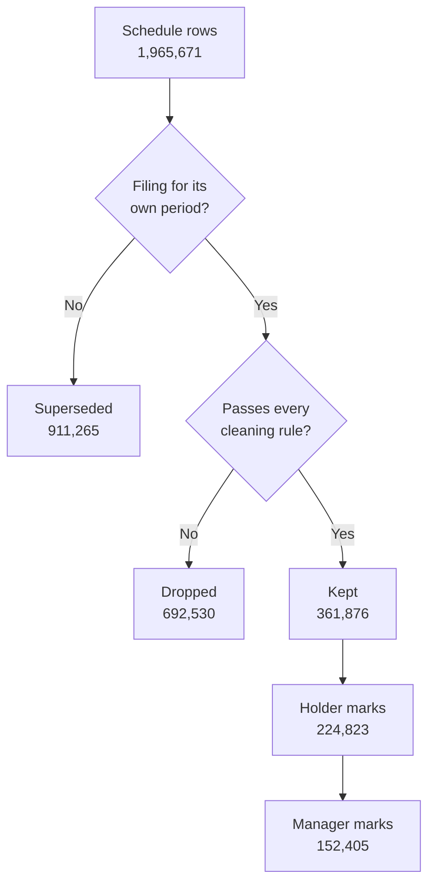

# Data

This document describes the inputs Syndicate uses, the rules that turn raw filings into a panel of
marks, and the format of that panel.

The repository contains no data. Every file described here is generated locally by
`scripts/pipeline.sh`.

## Contents

- [Sources](#sources)
- [Filling months the data sets have not published](#filling-months-the-data-sets-have-not-published)
- [From filings to marks](#from-filings-to-marks)
- [Cleaning rules](#cleaning-rules)
- [Borrower resolution](#borrower-resolution)
- [Panel schema](#panel-schema)
- [Synthetic market](#synthetic-market)

## Sources

| Source                                                                                          | Content                                                                                                     | Location        |
| ----------------------------------------------------------------------------------------------- | ----------------------------------------------------------------------------------------------------------- | --------------- |
| [SEC BDC data sets](https://www.sec.gov/data-research/sec-markets-data/bdc-data-sets)           | Monthly archives of the Schedule of Investments in every BDC's periodic filings, from late 2022.             | `data/raw/sec`  |
| [EDGAR](https://www.sec.gov/edgar/search/)                                                      | XBRL instance and label documents of periodic filings made in months the data sets do not yet cover.        | `data/raw/edgar` |
| [FRED](https://fred.stlouisfed.org/)                                                            | Daily public market series: corporate bond spreads, high-yield option-adjusted spreads, rates and equities. | `data/raw/fred` |

The SEC requires automated clients to declare a contact address. The downloader reads it from the
`SEC_CONTACT` environment variable, sends it in the `User-Agent` header, and does not run without it.
The address is not stored in the repository.

## Filling months the data sets have not published

The SEC publishes the BDC data sets monthly, by filing date, and a month can be missing or late. In
October 2026 the index listed archives for July and September 2026 but none for August, the month in
which most second-quarter reports were filed. Without it, most lenders' latest marks would date from
March 2026.

`ingest fetch-edgar` reads the filings of any uncovered month directly from EDGAR:

1. It lists every registrant that appears in the downloaded archives, and the months those archives
   cover.
2. For each registrant, it reads the EDGAR submissions index and selects periodic reports (10-Q,
   10-K and their amendments) filed in an uncovered month.
3. For each report, it downloads the XBRL instance and label documents and pivots every context that
   carries an investment identifier into one row, with the same columns as the data set's Schedule
   of Investments: the industry, identifier, affiliation, type, issuer, legal entity and currency
   axes, and the fair value, cost, principal, rate, margin and maturity tags. Explicit members are
   written as their filed labels, as in the data sets.
4. It writes one archive per month, `edgar_yyyy_mm_bdc.zip`, beside the SEC archives. Downloaded
   documents are kept compressed in `data/raw/edgar`, so a second run sends only the index requests.

The build reads both kinds of archive through the same parser. A filing present in more than one
archive is read from the first, and SEC archives sort first, so a month the SEC publishes later
replaces the filled one without double counting. `fetch-edgar` also deletes a filled archive once
the SEC covers its month.

The converter was checked against the published data set. The seven periodic reports filed in July
2026 were converted from EDGAR and compared with the SEC's July archive:

| Check                                                            | Result                  |
| ---------------------------------------------------------------- | ----------------------- |
| Identifier rows matched by filing, date and identifier           | 7,483 of 7,484          |
| Fair value, cost and principal on matched rows                   | Identical               |
| Panel rebuilt with July taken from EDGAR instead of the data set | Identical 208,442 marks |

The converted rows carry rates, margins and maturities on some rows where the data set leaves them
blank. These fields do not enter the price.

In October 2026 the gap fill added 173 reports filed in August and one filed in October, which
contribute 16,381 marks, most of them dated 30 June 2026.

## From filings to marks

A reporting date appears in the filing for its own period and again as the comparative column of
later filings. For each fund and reporting date, the filing for that period is authoritative, and
the earliest such filing sets the date on which the mark became public. Rows from other filings of
the same date are counted as superseded.

Counts in this document are from the panel built in October 2026 on the SEC archives and the
filled months.

### From rows to marks

Kept rows are collapsed twice. Each step sums principal, fair value and cost, so the price of a mark
is the principal-weighted price of its rows.

| Step                                                           |   Count | Reason                                                                                                      |
| -------------------------------------------------------------- | ------: | ----------------------------------------------------------------------------------------------------------- |
| Kept rows                                                      | 361,876 |                                                                                                             |
| Less rows in marks removed as reporting glitches               |     124 | 72 marks                                                                                                    |
| Holder marks: one per loan, fund and reporting date            | 224,823 | A fund lists one loan on several lines: drawn and delayed-draw portions, add-ons, and one line per vehicle. |
| Manager marks: one per loan, manager family and reporting date | 152,405 | Funds run by one manager are valued by one committee and are combined.                                      |

Of the holder marks, 143,505 come from a single row, 50,717 from two and 30,601 from three or more.
The model works with manager marks. `marks.tsv` keeps the holder level, and its `rows` column records
how many schedule rows each holder mark collapses.

### One loan per borrower

The panel holds 15,951 loans for 15,608 borrowers. Few borrowers have more than one loan, which is a
property of direct lending rather than of the matching rules:

- A loan is a borrower and a seniority class. Term loan, delayed-draw and revolving facilities of one
  seniority share collateral and documentation and are valued together, so they form one loan.
- In 95% of cases where a fund reports a borrower and seniority on a date, every line carries the
  same maturity month and margin. In the remaining 3,179 cases, half of the line prices differ by 0.5
  points or less.
- Senior debt dominates BDC portfolios. 688 borrowers have both a senior and a junior loan in the
  panel.

Where the lines of one borrower and seniority diverge persistently, the panel splits them into
separate loans (see [Distinct pieces of debt](#distinct-pieces-of-debt)).

## Cleaning rules

Every dropped row is counted in `data/build/ingest_report.json` under the rule that removed it.
Rules are listed by the number of rows they remove. Reporting glitches are detected after rows are
collapsed into marks, so that count is in marks.

| Rule                                  |    Rows | Reason                                                                                                                                       |
| ------------------------------------- | ------: | -------------------------------------------------------------------------------------------------------------------------------------------- |
| No identifier                         | 263,442 | The row carries no investment identifier to parse.                                                                                           |
| No fair value                         | 123,838 | The row carries no fair value.                                                                                                               |
| Equity or structured                  | 102,266 | The position is not a loan: equity, warrants or structured products.                                                                        |
| No principal                          |  88,103 | No positive principal, so no price can be computed.                                                                                         |
| Unfunded commitment                   |  44,863 | Undrawn commitments resemble loans marked near zero. Detected from the identifier, from cost well below principal, or from a low mark on a revolver or delayed-draw facility. |
| Non-dollar on another date            |  26,124 | A holding identified as non-dollar on any date is excluded on every date.                                                                    |
| Cost not that of a dollar loan at par |  18,910 | Cost outside 85% to 105% of principal, which indicates a different currency or unit.                                                         |
| No borrower name                      |  11,967 | No borrower name could be recovered from the identifier or the issuer axis.                                                                  |
| Non-dollar                            |   5,199 | Currency, reference rate or legal form indicates a loan denominated outside the dollar.                                                      |
| Price out of range                    |   5,170 | Fair value above 104% of principal.                                                                                                          |
| Inside a subsidiary                   |   2,648 | Held by a joint venture or subsidiary reported inside the filing, not by the registrant.                                                    |
| Reporting glitch                      |      72 | A mark that departs from both neighbours by twenty points in the same direction while they agree with each other.                           |

Two unit corrections are applied before the price is computed. A filer that reports principal in
thousands beside cost and fair value in dollars is detected by cost near a thousand times principal.
A row claiming five billion dollars or more of one loan is scaled down by a thousand.

### Distinct pieces of debt

One borrower and seniority can conceal more than one loan. The panel splits a series into separate
instruments when the marks show it:

| Sign                           | Instruments split |
| ------------------------------ | ----------------: |
| New paper after a restructuring |              144 |
| A different tranche            |                28 |

## Borrower resolution

Different lenders spell the same borrower differently. The resolver clusters spellings with four
rules, applied in order. Rules that match on a single common word require the loans' maturity month
and margin to agree as well.

| Rule                                         | Merges |
| -------------------------------------------- | -----: |
| Identical once legal form is removed         |  7,321 |
| Identical once deal-structure words removed  |    239 |
| As above, single word, corroborated by terms |     73 |
| Disclosed alias (`dba`, `fka`)               |    398 |
| Similar name with identical loan terms       |  3,871 |

On the real panel, 27,510 distinct spellings resolve to 15,608 borrowers. Of 15,951 loans, 6,498
are held by more than one fund and 3,525 by more than one manager family.

## Panel schema

`ingest build` writes the panel to `data/build` as tab-separated tables. Every date is a `yyyymmdd`
integer. The tables are the contract between the ingest program and the kernel.

### `holders.tsv`

One row per fund.

| Column   | Description                                  |
| -------- | -------------------------------------------- |
| `holder` | Holder identifier                            |
| `cik`    | SEC Central Index Key                        |
| `name`   | Registrant name                              |
| `family` | Manager family the fund belongs to           |
| `first`  | First reporting date                         |
| `last`   | Last reporting date                          |
| `marks`  | Number of marks                              |

### `borrowers.tsv`

One row per resolved borrower.

| Column      | Description                                         |
| ----------- | --------------------------------------------------- |
| `borrower`  | Borrower identifier                                 |
| `name`      | Display name, the spelling behind the most value    |
| `key`       | Normalised matching key                             |
| `sector`    | Industry sector                                     |
| `spellings` | Number of distinct spellings resolved to it         |
| `holders`   | Number of funds lending to it                       |
| `families`  | Number of manager families lending to it            |

### `instruments.tsv`

One row per loan.

| Column     | Description                                                   |
| ---------- | ------------------------------------------------------------- |
| `instrument` | Loan identifier                                             |
| `borrower` | Borrower identifier                                           |
| `class`    | Seniority class                                               |
| `holders`  | Number of funds holding it                                    |
| `families` | Number of manager families holding it                         |
| `marks`    | Number of marks                                               |
| `first`    | First reporting date                                          |
| `last`     | Last reporting date                                           |
| `piece`    | Index of the piece when one borrower and class holds several  |

### `marks.tsv`

One row per loan, holder and reporting date.

| Column       | Description                                              |
| ------------ | -------------------------------------------------------- |
| `instrument` | Loan identifier                                          |
| `holder`     | Holder identifier                                        |
| `asof`       | Reporting date the mark describes                        |
| `filed`      | Date the mark became public                              |
| `original`   | 1 if taken from the filing for its own period            |
| `price`      | Fair value divided by principal                          |
| `principal`  | Principal, in dollars                                    |
| `fair_value` | Fair value, in dollars                                   |
| `cost`       | Amortised cost, in dollars                               |
| `spread_bp`  | Margin over the reference rate, in basis points          |
| `maturity`   | Maturity date                                            |
| `rows`       | Number of schedule rows collapsed into the mark          |

### `tranches.tsv`

Marks at the level of individual tranches, before pieces are assigned, used to separate distinct
pieces of one borrower's debt.

| Column        | Description                         |
| ------------- | ----------------------------------- |
| `borrower`    | Borrower identifier                 |
| `class`       | Seniority class                     |
| `maturity_ym` | Maturity month, `yyyymm`            |
| `spread_bp`   | Margin, in basis points             |
| `holder`      | Holder identifier                   |
| `asof`        | Reporting date                      |
| `price`       | Fair value divided by principal     |
| `principal`   | Principal, in dollars               |

### `factors.tsv`

Daily public market series from FRED, one column per series. The kernel uses `baa_spread` as the
public credit factor.

### `ingest_report.json`

Counts for every stage: archives and rows read, rows superseded or already read from another
archive, kept and dropped by rule, pieces
split, holders, families, borrowers, instruments and marks, and the merges made by each resolution
rule.

## Synthetic market

`ingest synth` generates a market with a known answer and writes it in the SEC's own archive format,
so it passes through the same ingest and kernel code as the real filings. The market reproduces the
difficulties of real filings: lenders name the same borrower differently, write identifiers in
different grammars, file on different days, repeat prior periods as comparatives, and mix in equity,
unfunded commitments and non-dollar loans that must be filtered out. Nothing in it is, or is derived
from, a real company or a real mark.

The generator records the true value of every loan on every day, which `syndicate truth` uses to
score the daily estimates.

| Path                          | Content                                   |
| ----------------------------- | ----------------------------------------- |
| `data/synth/sec`              | Generated archives in the SEC file format |
| `data/synth/factors.tsv`      | Generated public market series            |
| `data/synth/truth_prices.tsv` | True value of every loan on every day     |
| `data/synth/truth_families.tsv` | True parameters of each lender family   |
| `data/synth/build`            | Panel built from the generated archives   |
