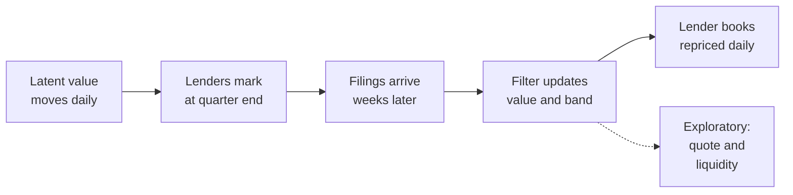
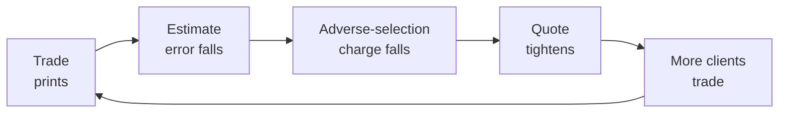

# Methodology

This document specifies the model behind Syndicate: how a loan's value evolves, how lenders' marks
relate to it, how the parameters are estimated, what the marks can and cannot identify, and how the
model is evaluated. The same specification, with the fitted values for the current panel, is on the
site's Method page.

All prices are fractions of par unless stated otherwise. Time is measured in trading days.

## Contents

- [Overview](#overview)
- [Value process](#value-process)
- [Measurement model](#measurement-model)
- [Delayed measurements](#delayed-measurements)
- [Information from other loans](#information-from-other-loans)
- [Jumps](#jumps)
- [Estimation](#estimation)
- [What the marks identify](#what-the-marks-identify)
- [Calibrated bands](#calibrated-bands)
- [Evaluation design](#evaluation-design)
- [Lender books](#lender-books)
- [Exploratory: from uncertainty to a quote](#exploratory-from-uncertainty-to-a-quote)
- [Exploratory: information and liquidity](#exploratory-information-and-liquidity)

## Overview



## Value process

The latent value $v_t$ is the mark a lender with no habits of its own would report on day $t$: the
holders' consensus once each lender's level, standing distance and delay are removed. It is never
observed, and it is not an independent fair value. Where every holder of a loan is too generous, so
is $v_t$. It moves each trading day with public credit markets, with a shock shared by its sector,
and with news of its own:

```math
v_t = v_{t-1} + \mu(v_{t-1}) + \beta(v_{t-1})\,x_t + s_t + u_t,
\qquad s_t \sim \mathcal N(0,\sigma_s^2),
\qquad u_t \sim \mathcal N\big(0,\sigma_u(v_{t-1})^2\big)
```

$x_t$ is the day's fall in a public credit spread. Sensitivity and volatility both rise as a loan
becomes stressed:

```math
\beta(v) = \beta_0 + \beta_1 (\bar v - v)^+,
\qquad \sigma_u(v) = \sigma_0 + \sigma_1 (\bar v - v)^+,
\qquad \bar v = 0.97
```

The drift $\mu$ pulls a performing loan back toward the level at which performing loans settle, at
one rate from below and another from above, and gives stressed loans a drift of their own.

## Measurement model

Lender $h$ marks the loan on a reporting date $a_q$, and the mark becomes public only when the
filing lands. A mark is not the latent value plus independent noise. Two lenders a point apart on a
loan this quarter are mostly still a point apart in the next: a lender's distance from the latent
value is persistent. The lender's view of the loan is

```math
\tilde m_{h,q} = v_{a_q} + b_h + d_{h,q},
\qquad d_{h,q} = \alpha\, d_{h,q-1} + \varepsilon_{h,q},
\qquad \varepsilon_{h,q} \sim \mathcal N\big(0,\,(1-\alpha^2)\, r_h^2\, g(v)^2\big)
```

with a level bias $b_h$, a distance of typical size $r_h$ that grows under stress through $g(v)$,
and a share $\alpha$ of that distance carried from each quarter to the next.

Lenders are also slow to incorporate news. When a change starts or ends below $\bar v$, the reported
mark closes only part of the gap to the new view:

```math
m_{h,q} = \varphi_h\, m_{h,q-1} + (1-\varphi_h)\,\tilde m_{h,q}
```

Inverting this relation recovers the view. A mark and the same lender's previous view then measure

```math
\tilde m_{h,q} - b_h - \alpha\,(\tilde m_{h,q-1} - b_h) = v_{a_q} - \alpha\, v_{a_{q-1}} + \varepsilon_{h,q}
```

which is a linear reading of two values, with only the fresh part of the disagreement as noise. A
lender's own history anchors its marks without any additional state per lender.

Only the core of a distance fades at rate $\alpha$, up to three of its own standard deviations.
Anything beyond the core is carried in full. Lenders ten points apart for two years usually hold
different pieces of the same borrower's debt, such as a first-out and a last-out tranche, rather
than disagreeing about one loan. A lender far from the rest is therefore carried at a rate close to
one, which also bounds its influence: it can pull the estimate toward itself only slowly, and a
majority in agreement always outweighs it.

## Delayed measurements

A mark is a measurement of the past. On each reporting date the filter copies the current value into
a slot, so the state becomes

```math
z_t = \big(v_t,\; c_t,\; v_{a_q},\; c_{a_q},\; v_{a_{q-1}},\; c_{a_{q-1}},\; \dots\big)
```

where $c$ is the sector's cumulative shock. The slots remain correlated with the present. When a
mark finally arrives, a reading $y$ of the combination $\ell = v_{a_q} - \alpha v_{a_{q-1}}$ corrects
today's estimate by exactly the right amount:

```math
\hat v_t \leftarrow \hat v_t + \frac{\operatorname{Cov}(v_t, \ell)}{\operatorname{Var}(\ell) + (1-\alpha^2)\, r_h^2}\,\big(y - \hat \ell\big)
```

This is the standard treatment of delayed measurements and is exact for a linear Gaussian model. It
is also why the band on every chart keeps widening past the end of a quarter and tightens only on
the filing date.

## Information from other loans

This component was tested and is not part of the model. It is described because the evaluation
reports it as an ablation.

The second slot component $c_a$ freezes the sector's cumulative shock over the quarter. Each loan is
filtered alone, which keeps thousands of loans tractable. The link between loans can then be
restored. Each loan's first mark of a quarter surprises the public forecast by

```math
\nu_j = s + (\text{own news and noise})
```

The precision-weighted mean of the other loans' surprises, accumulated week by week as they are
filed, is fed to each loan as an observation of $c_a$, with the loan's own surprise excluded. In
simulation, where sectors share shocks by construction, this improves accuracy. On the filings it
changes the forecast error by 0.01% across 97,521 forecasts, so the model leaves it out.
The sector shock remains part of each loan's volatility.

## Jumps

Credit does not diffuse into default. A Gaussian filter reads a ten-point fall as an extreme
valuation error and discounts it. The first mark of each reporting date is therefore tested against
a jump. With prior probability $p$ and jump variance $\sigma_J^2$, a surprise $\nu$ whose variance
without a jump would be $S$ gives the jump a posterior weight

```math
w = \frac{p\;\mathcal N(\nu;\,0,\,S+\sigma_J^2)}{p\;\mathcal N(\nu;\,0,\,S+\sigma_J^2) + (1-p)\;\mathcal N(\nu;\,0,\,S)}
```

The belief becomes a two-part mixture, each part updated on the mark, and is collapsed back to a
single Gaussian with the mixture's mean and covariance. Small surprises are filtered as noise; large
ones are believed.

## Estimation

No model parameter is hand-set. Each is identified by a different slice of the marks. A short list
of thresholds is fixed by design, such as the price of 97 below which a loan counts as stressed, and
the rules that clean the filings.

| Step | Quantity                               | Identification                                                                                                                                                                                                       |
| ---: | -------------------------------------- | -------------------------------------------------------------------------------------------------------------------------------------------------------------------------------------------------------------------- |
|    1 | Public sensitivity, drift, pull to par | Quarterly changes in the consensus mark are regressed on the change in the public spread. Each quarter is left out in turn and the sensitivity is shrunk by how far it moves.                                      |
|    2 | Marking lag                            | If peers' marks last quarter predict a lender's change this quarter, the lender is read as marking late, by the ratio of two covariances. No public market is required. The assumption behind this reading is discussed below. |
|    3 | Bias and distance                      | From how each lender's views sit against other lenders' views of the same loan on the same date. A fixed-point iteration separates the two sides' distances.                                                       |
|    4 | Persistence of disagreement            | A gap has a standing part and a transitory part. Its autocorrelations at one and two quarters are diluted equally by the transitory part, so their ratio gives the rate at which the standing part fades.          |
|    5 | Sector and loan volatility             | What public markets leave unexplained is split into a part shared by a sector within a quarter and a remainder, whose variance is fitted as a function of stress.                                                 |
|    6 | Jumps                                  | Frequency and size are estimated from the tail of the same residuals.                                                                                                                                                |

## What the marks identify

Marks identify differences between lenders well and absolute quantities poorly.

- **Level.** A lender's level bias is measured against other lenders of the same loan. A bias shared
  by every holder is invisible: the estimate is a consensus, not a fair value.
- **Delay.** The marking-lag step reads predictability of a lender's change from peers' earlier
  changes as late marking. This rests on the assumption that a loan's value has no trend of its
  own from one quarter to the next. A loan that kept deteriorating for its own reasons would produce
  the same pattern as a lender that marks it down late. The same problem arises when smoothing is
  read from the serial correlation of hedge fund or private equity returns, and it cannot be
  removed with marks alone.
- **A partial check.** Where the other holders of a loan move it by a point or more in a quarter and
  a lender does not, 20% of their move reaches that lender's mark in the next quarter, and the
  other holders themselves move a further 13% in the same direction (2,031 cases). The
  continuation is an estimate of the trend; only the difference is unambiguously late marking. The
  fitted lag shares are therefore upper bounds on lateness, and the Lenders page states them as
  such.
- **Persistence.** The share of a disagreement carried into the next quarter is identified from
  the ratio of its autocorrelations at one and two quarters, which a transitory component dilutes
  equally.

Testing the delay assumption properly requires an outside measure of value, such as secondary trade
prints or realised recoveries, which the filings do not contain.

## Calibrated bands

The model's standard deviation ranks forecasts by confidence, but credit has a floor of risk the
model does not see: the loan no one expected to move is the one that defaults. Errors are therefore
measured against the model's standard deviation plus the typical error of the regime, $f$,
separately for performing, watch-list and stressed loans. With scores

```math
e_i = \frac{|m_i - \hat m_i|}{\hat\sigma_i + f}
```

from $n$ earlier forecasts, the band at level $1-\alpha$ is

```math
\hat m \pm (\hat\sigma + f)\cdot e_{(k)},
\qquad k = \big\lceil (n+1)(1-\alpha) \big\rceil
```

This holds its stated coverage for any distribution of errors, provided they are exchangeable.
Across quarters they are not quite exchangeable: when marks move more than in any earlier quarter,
the band is too narrow for that quarter, and the Evidence page reports by how much. The same floors
and multipliers apply to the band around the value itself.

## Evaluation design

The evaluation is built so that every forecast uses only information available when it was made.

- **Walk-forward.** For each of ten quarters, the model is fitted on marks filed before the
  quarter ended, then forecasts each mark of that quarter on the day before the lender files it,
  using every mark filed by then, including other lenders' marks of the same quarter.
- **Target.** Forecasts are scored against the first-reported mark. When a later filing repeats a
  reporting date as a comparative, the panel keeps the original. Of 92,861 marks that
  can be matched to a later comparative, 629 (0.7%) changed by more than 0.1 points and
  402 (0.4%) by more than one point.
- **Ex-ante grouping.** Results are reported by information known at the forecast date, such as
  whether another lender had filed and how far the estimate had moved from the lender's last mark.
  Results grouped by the realised move are also shown, but such a grouping favours whichever
  forecast predicted the move.
- **Rules that saw later filings.** Borrower matching, the splitting of pieces of debt and several
  cleaning rules use every filing in the panel, including filings made after a forecast date.
  `scripts/vintage.sh` rebuilds the panel for each quarter from rows filed by 105 days after the
  quarter ended and repeats the backtest for that quarter. Pooled over the ten quarters, the share of
  squared error removed is 13.6% on panels rebuilt this way against 15.7% on the full
  panel, and 47% against 56% where another lender had filed. The rebuilt figures
  are the ones to expect in real time. The gap comes mostly from a few loans that were restructured:
  later filings show that the new paper is a separate loan, which the panel as it stood could not
  know.
- **Design choices.** The cleaning rules, the model and its estimation steps were designed on
  filings made up to July 2026. Reports filed in August 2026 were added afterwards from EDGAR, with
  no change to any rule. On 2026 Q2, mostly marked in those reports, the model removes
  15% of squared error across 11,215 forecasts.
- **Ablations.** Components that were tested and not adopted are reported beside the model, with
  their effect on the same forecasts.

## Lender books

A lender's debt book is the set of loans in its latest filing. Two quantities are computed for it.

**Calling the quarter.** In the backtest, every forecast of a lender's marks for one quarter is made
on the day before that lender files. For each lender and quarter with 20 or more continuing loans,
the principal-weighted average of the forecast changes is compared with the principal-weighted
average of the reported changes:

```math
\hat\Delta_{h,q} = \frac{\sum_i p_i\,(\hat m_{i} - m_{i,q-1})}{\sum_i p_i},
\qquad
\Delta_{h,q} = \frac{\sum_i p_i\,(m_{i,q} - m_{i,q-1})}{\sum_i p_i}
```

The share of the squared change anticipated is $1 - \sum (\Delta - \hat\Delta)^2 / \sum \Delta^2$,
against a forecast of no change. Across 663 lender-quarters it is 34%, and the
direction is right for 175 of 192 books that moved half a point or more. On panels
rebuilt as they stood at the time, the share is 37%. The share rises with the part of the
book that other holders have already marked: 19% below 20% and 53% at 40% or more.

**Movement since the last filing.** On any day, the site reprices each lender's book by the
principal-weighted move in the estimate of its loans between the day its latest filing was published
and that day. This is where the lender's marks would go if it followed the other holders, before its
own standing distance from them, and it is the quantity that matters for any vehicle that issues or
redeems shares at a net asset value set by those marks.

## Exploratory: from uncertainty to a quote

This section and the next are exploratory. They show how the uncertainty of an estimate would carry
into a dealer's spread and into liquidity. The desk's parameters, such as the rate of quote requests
and the share of informed clients, cannot be estimated from marks, and no trade data exists to test
the results. They are illustrations under stated assumptions, not estimates.

The half-spread is the sum of three charges, following the decomposition of Huang and Stoll. The
first two are the closed-form quotes of Guéant, Lehalle and Fernandez-Tapia for a dealer answering
requests that arrive at rate $A e^{-k\delta}$, with risk aversion $\gamma$ and daily variance
$\sigma^2$:

```math
\delta =
\underbrace{\frac{1}{\gamma}\ln\Big(1+\frac{\gamma}{k}\Big)}_{\text{making the market}}
+ \underbrace{\frac12\sqrt{\frac{\sigma^2\gamma}{2kA}\Big(1+\frac{\gamma}{k}\Big)^{1+k/\gamma}}}_{\text{carrying inventory}}
+ \underbrace{d(\pi)\,\hat\sigma_v}_{\text{adverse selection}}
```

The third charge follows Glosten and Milgrom. If a share $\pi$ of clients know the loan's value and
trade only when the quote is wrong in their favour, a dealer quoting $d$ standard errors from its
estimate breaks even where

```math
\frac{1-\pi}{2}\,d = \pi\,\big(\phi(d) - d\,\Phi(-d)\big)
```

The adverse-selection charge is linear in the standard error $\hat\sigma_v$ of the mark. Halving the
uncertainty halves that component of the spread.

## Exploratory: information and liquidity

A trade is also a measurement. Let $P$ be the variance of the market's estimate of a loan's value. It
grows at $\sigma^2$ a day and is reduced to $Pr/(P+r)$ by every observation with noise variance $r$.
Marks arrive on a schedule. Trades arrive at a rate that depends on the spread, which in turn depends
on $P$.



The process is piecewise-deterministic and is simulated exactly. Averaging over arrivals gives its
skeleton:

```math
\frac{dP}{dt} = \sigma^2 - \frac{1}{T_m}\frac{P^2}{P+r_m} - 2A\,e^{-k\,\delta(P)}\,\frac{P^2}{P+r_t}
```

The last term is hump-shaped in $P$: with little uncertainty there is little left to learn, and with
much the quote is too wide to trade on. Where the hump clears $\sigma^2$ there are three rest points,
two of them stable: a lit state, tight and traded, and a dark state, sustained by marks alone.
Setting the right-hand side to zero and solving for $A$ gives the surface on the Desk page as an
explicit graph over $P$, and a rest point is stable exactly where $dA/dP < 0$.

The skeleton shows where two regimes exist but not how a loan moves between them. A single print on
a dark loan is often enough, on its own, to relight it. The process is metastable: it remains in
each regime for a time and jumps between them. Time spent in each regime, and what changes it, are
estimated by simulation.
