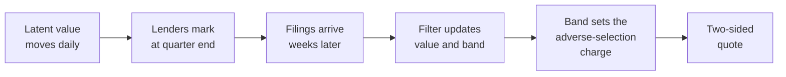
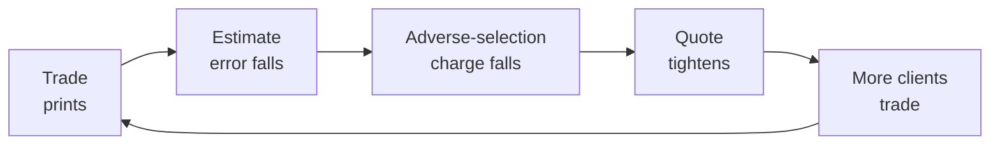

# Methodology

This document specifies the model behind Syndicate: how a loan's value evolves, how lenders' marks
relate to it, how the parameters are estimated, and how the resulting uncertainty becomes a quote.
The same specification, with the fitted values for the current panel, is on the site's Method page.

All prices are fractions of par unless stated otherwise. Time is measured in trading days.

## Contents

- [Overview](#overview)
- [Value process](#value-process)
- [Measurement model](#measurement-model)
- [Delayed measurements](#delayed-measurements)
- [Information from other loans](#information-from-other-loans)
- [Jumps](#jumps)
- [Estimation](#estimation)
- [Calibrated bands](#calibrated-bands)
- [From uncertainty to a quote](#from-uncertainty-to-a-quote)
- [Information and liquidity](#information-and-liquidity)

## Overview



## Value process

A loan's fair value $v_t$ is never observed. It moves each trading day with public credit markets,
with a shock shared by its sector, and with news of its own:

```math
v_t = v_{t-1} + \mu(v_{t-1}) + \beta(v_{t-1})\,x_t + s_t + u_t,
\qquad s_t \sim \mathcal N(0,\sigma_s^2),
\qquad u_t \sim \mathcal N\big(0,\sigma_u(v_{t-1})^2\big)
```

$x_t$ is the day's fall in a public credit spread. Sensitivity and volatility both rise as a loan
becomes stressed:

```math
\beta(v) = \beta_0 + \beta_1 (\bar v - v)^+,
\qquad \sigma_u(v) = \sigma_0 + \sigma_1 (\bar v - v)^+,
\qquad \bar v = 0.97
```

The drift $\mu$ pulls a performing loan back toward the level at which performing loans settle, at
one rate from below and another from above, and gives stressed loans a drift of their own.

## Measurement model

Lender $h$ marks the loan on a reporting date $a_q$, and the mark becomes public only when the
filing lands. A mark is not fair value plus independent noise. Two lenders a point apart on a loan
this quarter are mostly still a point apart in the next: a lender's distance from fair value is
persistent. The lender's view of the loan is

```math
\tilde m_{h,q} = v_{a_q} + b_h + d_{h,q},
\qquad d_{h,q} = \alpha\, d_{h,q-1} + \varepsilon_{h,q},
\qquad \varepsilon_{h,q} \sim \mathcal N\big(0,\,(1-\alpha^2)\, r_h^2\, g(v)^2\big)
```

with a level bias $b_h$, a distance of typical size $r_h$ that grows under stress through $g(v)$,
and a share $\alpha$ of that distance carried from each quarter to the next.

Lenders are also slow to incorporate news. When a change starts or ends below $\bar v$, the reported
mark closes only part of the gap to the new view:

```math
m_{h,q} = \varphi_h\, m_{h,q-1} + (1-\varphi_h)\,\tilde m_{h,q}
```

Inverting this relation recovers the view. A mark and the same lender's previous view then measure

```math
\tilde m_{h,q} - b_h - \alpha\,(\tilde m_{h,q-1} - b_h) = v_{a_q} - \alpha\, v_{a_{q-1}} + \varepsilon_{h,q}
```

which is a linear reading of two values, with only the fresh part of the disagreement as noise. A
lender's own history anchors its marks without any additional state per lender.

Only the core of a distance fades at rate $\alpha$, up to three of its own standard deviations.
Anything beyond the core is carried in full. Lenders ten points apart for two years usually hold
different pieces of the same borrower's debt, such as a first-out and a last-out tranche, rather
than disagreeing about one loan. A lender far from the rest is therefore carried at a rate close to
one, which also bounds its influence: it can pull the estimate toward itself only slowly, and a
majority in agreement always outweighs it.

## Delayed measurements

A mark is a measurement of the past. On each reporting date the filter copies the current value into
a slot, so the state becomes

```math
z_t = \big(v_t,\; c_t,\; v_{a_q},\; c_{a_q},\; v_{a_{q-1}},\; c_{a_{q-1}},\; \dots\big)
```

where $c$ is the sector's cumulative shock. The slots remain correlated with the present. When a
mark finally arrives, a reading $y$ of the combination $\ell = v_{a_q} - \alpha v_{a_{q-1}}$ corrects
today's estimate by exactly the right amount:

```math
\hat v_t \leftarrow \hat v_t + \frac{\operatorname{Cov}(v_t, \ell)}{\operatorname{Var}(\ell) + (1-\alpha^2)\, r_h^2}\,\big(y - \hat \ell\big)
```

This is the standard treatment of delayed measurements and is exact for a linear Gaussian model. It
is also why the band on every chart keeps widening past the end of a quarter and tightens only on
the filing date.

## Information from other loans

The second slot component $c_a$ freezes the sector's cumulative shock over the quarter. Each loan is
filtered alone, which keeps thousands of loans tractable, and the link between them is then
restored. Each loan's first mark of a quarter surprises the public forecast by

```math
\nu_j = s + (\text{own news and noise})
```

The precision-weighted mean of the other loans' surprises, accumulated week by week as they are
filed, is fed to each loan as an observation of $c_a$. The loan's own surprise is excluded, so it
never observes itself.

## Jumps

Credit does not diffuse into default. A Gaussian filter reads a ten-point fall as an extreme
valuation error and discounts it. The first mark of each reporting date is therefore tested against
a jump. With prior probability $p$ and jump variance $\sigma_J^2$, a surprise $\nu$ whose variance
without a jump would be $S$ gives the jump a posterior weight

```math
w = \frac{p\;\mathcal N(\nu;\,0,\,S+\sigma_J^2)}{p\;\mathcal N(\nu;\,0,\,S+\sigma_J^2) + (1-p)\;\mathcal N(\nu;\,0,\,S)}
```

The belief becomes a two-part mixture, each part updated on the mark, and is collapsed back to a
single Gaussian with the mixture's mean and covariance. Small surprises are filtered as noise; large
ones are believed.

## Estimation

No model parameter is hand-set. Each is identified by a different slice of the marks. A short list
of thresholds is fixed by design, such as the price of 97 below which a loan counts as stressed, and
the rules that clean the filings.

| Step | Quantity                               | Identification                                                                                                                                                                                                       |
| ---: | -------------------------------------- | -------------------------------------------------------------------------------------------------------------------------------------------------------------------------------------------------------------------- |
|    1 | Public sensitivity, drift, pull to par | Quarterly changes in the consensus mark are regressed on the change in the public spread. Each quarter is left out in turn and the sensitivity is shrunk by how far it moves.                                      |
|    2 | Marking lag                            | A fair value cannot be forecast from its own past. If peers' marks last quarter predict a lender's change this quarter, the lender is marking late, by the ratio of two covariances. No public market is required. |
|    3 | Bias and distance                      | From how each lender's views sit against other lenders' views of the same loan on the same date. A fixed-point iteration separates the two sides' distances.                                                       |
|    4 | Persistence of disagreement            | A gap has a standing part and a transitory part. Its autocorrelations at one and two quarters are diluted equally by the transitory part, so their ratio gives the rate at which the standing part fades.          |
|    5 | Sector and loan volatility             | What public markets leave unexplained is split into a part shared by a sector within a quarter and a remainder, whose variance is fitted as a function of stress.                                                 |
|    6 | Jumps                                  | Frequency and size are estimated from the tail of the same residuals.                                                                                                                                                |

## Calibrated bands

The model's standard deviation ranks forecasts by confidence, but credit has a floor of risk the
model does not see: the loan no one expected to move is the one that defaults. Errors are therefore
measured against the model's standard deviation plus the typical error of the regime, $f$,
separately for performing, watch-list and stressed loans. With scores

```math
e_i = \frac{|m_i - \hat m_i|}{\hat\sigma_i + f}
```

from $n$ earlier forecasts, the band at level $1-\alpha$ is

```math
\hat m \pm (\hat\sigma + f)\cdot e_{(k)},
\qquad k = \big\lceil (n+1)(1-\alpha) \big\rceil
```

This holds its stated coverage for any distribution of errors, provided they are exchangeable.
Across quarters they are not quite exchangeable: when marks move more than in any earlier quarter,
the band is too narrow for that quarter, and the Evidence page reports by how much. The same floors
and multipliers apply to the band around the value itself.

## From uncertainty to a quote

The half-spread is the sum of three charges, following the decomposition of Huang and Stoll. The
first two are the closed-form quotes of Guéant, Lehalle and Fernandez-Tapia for a dealer answering
requests that arrive at rate $A e^{-k\delta}$, with risk aversion $\gamma$ and daily variance
$\sigma^2$:

```math
\delta =
\underbrace{\frac{1}{\gamma}\ln\Big(1+\frac{\gamma}{k}\Big)}_{\text{making the market}}
+ \underbrace{\frac12\sqrt{\frac{\sigma^2\gamma}{2kA}\Big(1+\frac{\gamma}{k}\Big)^{1+k/\gamma}}}_{\text{carrying inventory}}
+ \underbrace{d(\pi)\,\hat\sigma_v}_{\text{adverse selection}}
```

The third charge follows Glosten and Milgrom. If a share $\pi$ of clients know the loan's value and
trade only when the quote is wrong in their favour, a dealer quoting $d$ standard errors from its
estimate breaks even where

```math
\frac{1-\pi}{2}\,d = \pi\,\big(\phi(d) - d\,\Phi(-d)\big)
```

The adverse-selection charge is linear in the standard error $\hat\sigma_v$ of the mark. Halving the
uncertainty halves that component of the spread.

## Information and liquidity

A trade is also a measurement. Let $P$ be the variance of the market's estimate of a loan's value. It
grows at $\sigma^2$ a day and is reduced to $Pr/(P+r)$ by every observation with noise variance $r$.
Marks arrive on a schedule. Trades arrive at a rate that depends on the spread, which in turn depends
on $P$.



The process is piecewise-deterministic and is simulated exactly. Averaging over arrivals gives its
skeleton:

```math
\frac{dP}{dt} = \sigma^2 - \frac{1}{T_m}\frac{P^2}{P+r_m} - 2A\,e^{-k\,\delta(P)}\,\frac{P^2}{P+r_t}
```

The last term is hump-shaped in $P$: with little uncertainty there is little left to learn, and with
much the quote is too wide to trade on. Where the hump clears $\sigma^2$ there are three rest points,
two of them stable: a lit state, tight and traded, and a dark state, sustained by marks alone.
Setting the right-hand side to zero and solving for $A$ gives the surface on the Desk page as an
explicit graph over $P$, and a rest point is stable exactly where $dA/dP < 0$.

The skeleton shows where two regimes exist but not how a loan moves between them. A single print on
a dark loan is often enough, on its own, to relight it. The process is metastable: it remains in
each regime for a time and jumps between them. Time spent in each regime, and what changes it, are
estimated by simulation.
