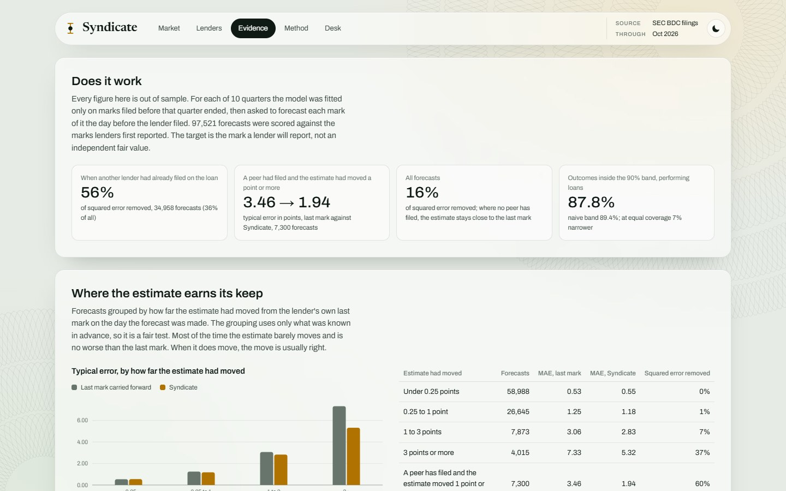

# Results

This document reports every result behind the summary in the README. All figures are from the
panel built in October 2026 and can be reproduced with the commands at the end. The evaluation
design is specified in [methodology.md](methodology.md#evaluation-design).

Errors are in price points, with par at 100. "Squared error removed" is one less the ratio of the
model's squared error to that of carrying the lender's last mark forward. A negative value means
more squared error than the last mark.

## Contents

- [Design in brief](#design-in-brief)
- [Accuracy by source of information](#accuracy-by-source-of-information)
- [Accuracy by what was known in advance](#accuracy-by-what-was-known-in-advance)
- [Accuracy by realised move](#accuracy-by-realised-move)
- [Accuracy by regime](#accuracy-by-regime)
- [Point-in-time audit](#point-in-time-audit)
- [Lender books](#lender-books)
- [Calibrated bands](#calibrated-bands)
- [Ablation](#ablation)
- [What the filings show](#what-the-filings-show)
- [Software verification on a synthetic market](#software-verification-on-a-synthetic-market)
- [Reproducing these results](#reproducing-these-results)

## Design in brief

- Ten test quarters, 2024 Q1 to 2026 Q2, and 97,521 forecasts.
- For each quarter the model is fitted on marks filed before the quarter ended.
- Each mark of the quarter is forecast on the day before its lender files, from every mark public
  by then, including other lenders' marks of the same quarter.
- The target is the first-reported mark. Later comparatives are not used.

## Accuracy by source of information

Each row adds one source of information to the row above and is scored on the same forecasts.

| Information used                                   | MAE  | RMSE | Squared error against the last mark |
| -------------------------------------------------- | ---: | ---: | ----------------------------------- |
| Last mark carried forward                          | 1.21 | 3.94 |                                     |
| Rolled forward with public spreads and pull to par | 1.50 | 4.42 | 26% more                            |
| With each lender's habits modelled                 | 1.24 | 3.87 | 4% less                             |
| With other lenders' marks of the same loan         | 1.10 | 3.61 | 16% less                            |

Where another lender had already filed the loan (34,958 forecasts, 36% of the total):

| Information used                                   | MAE  | RMSE | Squared error against the last mark |
| -------------------------------------------------- | ---: | ---: | ----------------------------------- |
| Last mark carried forward                          | 1.08 | 3.17 |                                     |
| Rolled forward with public spreads and pull to par | 1.35 | 3.65 | 32% more                            |
| With each lender's habits modelled                 | 1.10 | 3.10 | 4% less                             |
| With other lenders' marks of the same loan         | 0.71 | 2.10 | 56% less                            |

- **Treating marks as fair value plus noise fails.** Rolled forward with public spreads, marks
  taken at face value forecast worse than the last mark, because a model that reads a lender's
  standing distance as noise keeps pulling the mark toward the average.
- **Modelling each lender's habits restores parity** with the last mark. Before another lender has
  filed, little further information is available.
- **Other lenders' marks carry the information.** Once another holder has filed, more than half of
  the squared error is removed.

## Accuracy by what was known in advance

Forecasts are grouped by how far the estimate had moved from the lender's own last mark on the day
the forecast was made. The grouping uses only information available at the time, so it is a fair
comparison of the two forecasts.

| Estimate had moved                                    | Forecasts | MAE, last mark | MAE, model | Squared error removed |
| ----------------------------------------------------- | --------: | -------------: | ---------: | --------------------: |
| Under 0.25 points                                     |    58,988 |           0.53 |       0.55 |                    0% |
| 0.25 to 1 point                                       |    26,645 |           1.25 |       1.18 |                    1% |
| 1 to 3 points                                         |     7,873 |           3.06 |       2.83 |                    7% |
| 3 points or more                                      |     4,015 |           7.33 |       5.32 |                   37% |
| A peer had filed and the estimate moved 1 point or more |   7,300 |           3.46 |       1.94 |                   60% |

Most of the time the estimate barely moves and is neither better nor worse than the last mark. When
it moves, the move is informative, and it is most informative when it comes from another holder's
filing.



## Accuracy by realised move

Review asked for errors on loans that actually moved. Grouping by the realised move favours whichever
forecast predicted it, and on marks that did not move the last mark is right by construction, so
these groups should be read together.

| Marks                       | Forecasts | MAE, last mark | MAE, model | RMSE, last mark | RMSE, model |
| --------------------------- | --------: | -------------: | ---------: | --------------: | ----------: |
| Moved 1 point or more       |    23,166 |           4.33 |       3.49 |            8.05 |        7.25 |
| Moved 3 points or more      |     8,298 |           9.09 |       7.24 |           13.24 |       11.86 |
| Moved less than 1 point     |    74,355 |           0.24 |       0.36 |            0.37 |        0.86 |

## Accuracy by regime

Regimes are set by the lender's previous mark: performing at 97 or above, watch list from 90 to 97,
stressed below 90.

| Regime     | Forecasts | MAE, last mark | MAE, model | Squared error removed |
| ---------- | --------: | -------------: | ---------: | --------------------: |
| Performing |    80,635 |           0.60 |       0.56 |                    9% |
| Watch list |    10,158 |           2.61 |       2.20 |                   25% |
| Stressed   |     6,728 |           6.48 |       5.95 |                   15% |

## Point-in-time audit

### Restatements

When a later filing repeats a reporting date as a comparative, the panel keeps the first-reported
mark. Of 92,861 marks that can be matched to a later comparative of the same identifier, 629 (0.7%)
changed by more than 0.1 points and 402 (0.4%) by more than one point. The mean absolute change is
0.16 points.

### Rules that saw later filings

Borrower matching, the splitting of one borrower's debt into separate loans and several cleaning
rules use every filing in the panel. `scripts/vintage.sh` rebuilds the panel for each test quarter
from rows filed by 105 days after the quarter ended, and repeats the backtest for that quarter.

| Quarter | Forecasts | RMSE, last mark | RMSE, model | Removed, full panel | Removed, panel as it stood | Peer filed, full panel | Peer filed, panel as it stood |
| ------- | --------: | --------------: | ----------: | ------------------: | -------------------------: | ---------------------: | ----------------------------: |
| 2024 Q1 |     7,405 |            3.77 |        3.66 |                  6% |                         2% |                    34% |                           20% |
| 2024 Q2 |     8,172 |            4.53 |        4.17 |                 15% |                        14% |                    67% |                           49% |
| 2024 Q3 |     8,943 |            3.27 |        3.14 |                  8% |                         3% |                    53% |                           21% |
| 2024 Q4 |     9,361 |            4.12 |        3.84 |                 13% |                        13% |                    62% |                           58% |
| 2025 Q1 |     9,963 |            3.63 |        3.48 |                  8% |                         9% |                    41% |                           45% |
| 2025 Q2 |    10,077 |            3.37 |        3.31 |                  3% |                         3% |                     0% |                           -4% |
| 2025 Q3 |    10,599 |            4.17 |        3.59 |                 26% |                        19% |                    74% |                           53% |
| 2025 Q4 |    10,546 |            3.87 |        3.60 |                 13% |                        12% |                    45% |                           32% |
| 2026 Q1 |    11,240 |            4.51 |        3.76 |                 31% |                        30% |                    69% |                           68% |
| 2026 Q2 |    11,215 |            3.88 |        3.57 |                 15% |                        15% |                    46% |                           46% |
| Pooled  |    97,521 |            3.94 |        3.61 |                 16% |                        14% |                    56% |                           47% |

The first four columns are from the full panel. Pooled over the ten quarters, the panel as it stood
removes 14% of squared error, and 47% where another lender had filed. Where a peer had filed and the
estimate had moved a point or more, mean absolute error falls from 3.55 to 2.07 points. These are
the figures to expect in real time.

The gap is concentrated in a few early quarters and a few loans. In 2024 Q3, two loans account for
43% of the squared error on peer-filed forecasts on the panel as it stood. In one, the full panel
splits a lender's diverging marks into a separate loan once the next quarter confirms the
divergence. In the other, it removes a mark that the next filing reverses, under the reporting
glitch rule. Neither rule can act until the next filing arrives.

The model removes squared error in every quarter on both panels. Where a peer had filed, 2025 Q2 is
level with the last mark on the full panel and 4% worse on the panel as it stood; every other
quarter shows a gain.

### Design choices

The cleaning rules, the model and its estimation steps were designed on filings made up to July
2026. Reports filed in August 2026 were added afterwards from EDGAR without changing any rule. 2026
Q2, mostly marked in those reports, removes 15% of squared error across 11,215 forecasts, in line
with the earlier quarters.

## Lender books

For each lender and quarter with 20 or more continuing loans, the principal-weighted change the
model expected on the day before the lender filed is compared with the change it reported.

| Book already marked by other holders | Lender-quarters | Squared change anticipated | Direction right, books that moved half a point or more |
| ------------------------------------ | --------------: | -------------------------: | -------------------------------------------------------: |
| Under 20%                            |             252 |                        19% |                                                 74 of 84 |
| 20% to 40%                           |             167 |                        42% |                                                 51 of 55 |
| 40% or more                          |             244 |                        53% |                                                 50 of 53 |
| All                                  |             663 |                        34% |                                               175 of 192 |

- Without other holders' marks, rolling each book forward with public spreads, the pull to par and
  each lender's own habits anticipates 17%.
- The typical book moved 0.50 points in a quarter and was called to within 0.39 points.
- On the panels rebuilt as they stood, 37% of the squared change is anticipated and the direction is
  right for 184 of 205 books.

## Calibrated bands

| Regime     | Forecasts | Gaussian 90% band held | Calibrated 90% band held | Naive 90% band held | Width, model, at equal coverage | Width, naive, at equal coverage |
| ---------- | --------: | ---------------------: | -----------------------: | ------------------: | ------------------------------: | ------------------------------: |
| Performing |    74,824 |                  77.2% |                    87.8% |               89.4% |                            2.47 |                            2.67 |
| Watch list |     9,084 |                  56.1% |                    88.3% |               88.1% |                           10.15 |                           11.50 |
| Stressed   |     6,208 |                  73.3% |                    90.4% |               90.4% |                           29.56 |                           33.63 |

The naive band is the last mark plus or minus the historical range of quarterly moves. Bands that
miss their stated coverage by different amounts cannot be compared on width alone, so both are also
scaled to hold exactly 90% of outcomes; at equal coverage the model's band is 7% narrower for
performing loans and 12% narrower for watch-list and stressed loans. The calibrated band falls about
two points short of its stated coverage for performing and watch-list loans. In 2026 Q1 a quarter of
performing loans moved by more than a point, compared with a fifth or fewer in every earlier
quarter, and bands calibrated on earlier quarters did not anticipate it. The shortfall is reported
rather than tuned away.

## Ablation

| Component                            | Effect on RMSE, all forecasts | Status                                          |
| ------------------------------------ | ----------------------------: | ----------------------------------------------- |
| Sector repricing from other loans    |                        -0.01% | Not adopted. Helps in simulation only.          |

The component feeds each loan the precision-weighted surprises of other loans in its sector as they
are filed. In the synthetic market, where sectors share shocks by construction, it removes a
further 1.6 points of squared error. On the filings it changes nothing measurable, so the model
leaves it out and the backtest continues to score it.

## What the filings show

These are read directly from the marks, on the 24,645 occasions when more than one lender reported
the same loan on the same date.

| Regime     | Occasions | Median range of marks | 90th percentile | Share more than 1 point apart |
| ---------- | --------: | --------------------: | --------------: | ----------------------------: |
| Performing |    19,768 |                  0.50 |            2.39 |                           33% |
| Watch list |     3,208 |                  2.31 |            8.92 |                           64% |
| Stressed   |     1,669 |                  4.09 |           22.45 |                           72% |

- **Persistence.** 72% of the distance between one lender's mark and its peers' marks on the same
  loan remains a quarter later.
- **Timing.** When the other holders move a loan by a point or more and a lender does not, 20% of
  their move reaches the lender in the next quarter and the other holders move a further 13% the
  same way (2,031 cases). The fitted share of news carried into the next quarter is 0.22 on average,
  0.21 where the lender's own mark was already below 97 and 0.60 where only the other lenders had it
  there. Because a trend in value cannot be told apart from late marking, these are upper bounds.
- **Pull to par.** Marks are pulled toward par by 14% per quarter from below and 26% from above.
- **Public spreads.** Quarterly changes in public credit spreads explain 0.6% of the variation in
  marks.
- **Disagreement and distress.** Disagreement ranks which shared loans will be marked down three
  points or more in the next quarter with an AUC of 0.65, but only because loans already in
  difficulty are both disputed and fragile. Among performing loans the AUC is 0.49.

## Software verification on a synthetic market

Observed data cannot show whether estimates between marks are correct, because the value is never
observed. The repository includes a generator that writes a market in the SEC's file format with
the measurement structure found in the filings, and records the true value of every loan on every
day. The same code runs on both.

The generator uses the model's own structure, so recovering its parameters shows that the code is
correct. It does not show that the model describes real lenders.

| Parameter set in the generator                 | True | Recovered |
| ---------------------------------------------- | ---: | --------: |
| Share of a disagreement carried a quarter      | 0.80 |      0.78 |
| Share of an old mark carried, under stress     | 0.23 |      0.20 |
| Pull to par, per quarter                       | 0.14 |      0.14 |
| Public sensitivity, points per point of spread | 1.20 |      1.17 |

Against the true value between marks, the typical error is 0.52 points, against 0.72 for the stale
marks a holder would otherwise use, and the 90% band holds the true value 89% of the time.

## Reproducing these results

```sh
bash scripts/pipeline.sh sec                                   # panel, fit, backtest and site files
./kernel/target/release/syndicate fit data/build               # parameters and lender findings
./kernel/target/release/syndicate backtest data/build          # every accuracy table above
bash scripts/vintage.sh                                        # the point-in-time audit
bash scripts/pipeline.sh synthetic
./kernel/target/release/syndicate truth data/synth/build       # software verification
```

On Windows the programs carry the `.exe` suffix.
